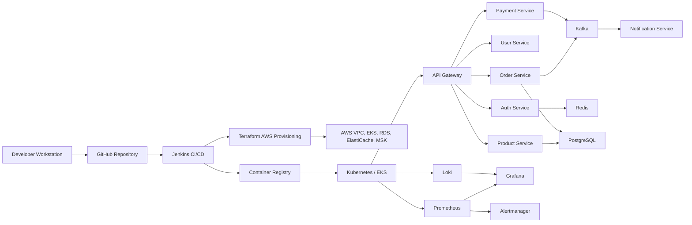

# Production Engineering Masterclass: Build Real Systems From Zero To Enterprise

This course is not notes. It is a build path. Every module creates working files, commands, deployment steps, debugging commands, security controls, monitoring, and production hardening.

## Phase 1: What Are We Building?

We are building a complete production engineering platform:

1. A local engineering workstation.
2. A secure AWS account foundation.
3. Dockerized Python, Node, FastAPI, Django, and React applications.
4. A production FastAPI application with PostgreSQL and Redis.
5. Kubernetes deployments with Services, Ingress, ConfigMaps, Secrets, Persistent Volumes, Helm, and ArgoCD.
6. AWS infrastructure using Terraform.
7. CI/CD with Jenkins.
8. Observability with Prometheus, Grafana, Loki, and alerting.
9. Security hardening for cloud, containers, Kubernetes, secrets, IAM, and networks.
10. Kafka and Redis systems for event-driven production platforms.
11. A microservices platform with Auth, User, Product, Order, Payment, Notification, API Gateway, Kafka, Redis, observability, and CI/CD.

## Phase 2: Why Does It Exist?

Production systems exist because real companies need software that:

1. Runs reliably.
2. Survives failures.
3. Scales when traffic increases.
4. Protects user data.
5. Can be deployed repeatedly without manual mistakes.
6. Can be monitored when something breaks.
7. Can be debugged by engineers under pressure.
8. Can be audited by security and compliance teams.

## Phase 3: Real World Use Case

The final target is an e-commerce style platform:

1. Users register and log in.
2. Products are listed.
3. Orders are created.
4. Payments are processed through an external provider.
5. Notifications are sent after important events.
6. Kafka moves business events between services.
7. Redis handles caching, sessions, rate limiting, and locks.
8. Kubernetes runs services.
9. Terraform creates cloud infrastructure.
10. Jenkins builds, tests, scans, packages, and deploys.
11. Prometheus, Grafana, and Loki monitor the platform.

## Phase 4: Architecture Diagram



## Phase 5: Prerequisites

You need:

1. A Windows, macOS, or Linux computer.
2. Internet access.
3. A browser.
4. A terminal.
5. Git.
6. Docker Desktop or Docker Engine.
7. Visual Studio Code.
8. An AWS account.
9. A GitHub account.
10. Patience to type commands carefully and read errors slowly.

## Phase 6: Installation Path

Read and execute the files in this order:

1. `01-aws-account-iam-billing.md`
2. `02-workstation-linux-git.md`
3. `03-docker-from-zero-to-production.md`
4. `04-fastapi-postgres-redis-production-api.md`
5. `05-kubernetes-from-zero-to-gitops.md`
6. `06-terraform-aws-production-infrastructure.md`
7. `07-jenkins-cicd-production-pipeline.md`
8. `08-observability-monitoring-alerting.md`
9. `09-security-hardening.md`
10. `10-kafka-redis-event-driven-systems.md`
11. `11-production-microservices-platform.md`

## Phase 7: Hands-On Implementation Rules

Every project uses this implementation rhythm:

1. Create a real folder.
2. Create real source files.
3. Run locally.
4. Add tests.
5. Dockerize.
6. Run with Docker Compose.
7. Add production configuration.
8. Add CI/CD.
9. Deploy to Kubernetes or AWS.
10. Add monitoring.
11. Add alerts.
12. Debug failures.
13. Harden security.
14. Scale and recover.

## Phase 8: Production Implementation Standards

Every service must have:

1. Health endpoint.
2. Readiness endpoint.
3. Structured logs.
4. Metrics endpoint.
5. Dockerfile.
6. Non-root container user.
7. Environment-based configuration.
8. Database migrations when using a database.
9. Automated tests.
10. CI/CD pipeline.
11. Kubernetes manifests or Helm chart.
12. Resource requests and limits.
13. Secret handling.
14. Rollback strategy.

## Phase 9: Monitoring Standards

Every production deployment must answer:

1. Is the service up?
2. Is it receiving traffic?
3. Is it returning errors?
4. Is latency acceptable?
5. Is CPU high?
6. Is memory high?
7. Is disk filling?
8. Is the database healthy?
9. Are background jobs stuck?
10. Are users affected?

## Phase 10: Debugging Standards

For every failure:

1. Read the error message.
2. Reproduce the failure.
3. Check logs.
4. Check metrics.
5. Check recent deployments.
6. Check configuration.
7. Check network paths.
8. Check credentials and permissions.
9. Apply the smallest fix.
10. Verify the fix.
11. Document the command that proved the fix.

## Phase 11: Security Standards

Every project uses:

1. Least privilege IAM.
2. MFA for human users.
3. Secrets outside source code.
4. Private networking for databases.
5. TLS for public traffic.
6. Container vulnerability scanning.
7. Dependency scanning.
8. Audit logging.
9. Backup encryption.
10. Rotation plans for credentials.

## Phase 12: Scaling Standards

Every system must define:

1. Horizontal scaling.
2. Vertical scaling.
3. Database scaling.
4. Queue scaling.
5. Cache scaling.
6. Rate limits.
7. Load tests.
8. Capacity estimates.
9. Bottleneck diagnosis.
10. Cost impact.

## Phase 13: Cost Optimization Standards

Cost is controlled through:

1. Budget alerts.
2. Right-sized instances.
3. Autoscaling.
4. Storage lifecycle policies.
5. Log retention.
6. Reserved capacity when stable.
7. Spot instances for safe workloads.
8. Removing unused resources.
9. Tagging every cloud resource.
10. Reviewing bills weekly.

## Phase 14: Enterprise Architecture Standards

Enterprise-ready systems include:

1. Separate dev, staging, and production environments.
2. Centralized identity.
3. Centralized logging.
4. Centralized monitoring.
5. Infrastructure as code.
6. Change control.
7. Disaster recovery.
8. Compliance evidence.
9. Incident response.
10. Runbooks.

## Command Explanation Template Used In Every Module

Every major command is explained with:

1. Purpose.
2. Why it exists.
3. Command.
4. Expected output.
5. Common errors.
6. Fixes.

Example:

```bash
docker ps
```

Purpose:
Lists running containers.

Why it exists:
You use it to confirm whether your application container, database container, cache container, or supporting service is currently running.

Expected output:

```text
CONTAINER ID   IMAGE     COMMAND      STATUS       PORTS
abc123         nginx     "nginx..."   Up 2 min     0.0.0.0:8080->80/tcp
```

Common error:

```text
Cannot connect to the Docker daemon
```

Fix:

1. Start Docker Desktop.
2. Wait until Docker says it is running.
3. Run the command again.

