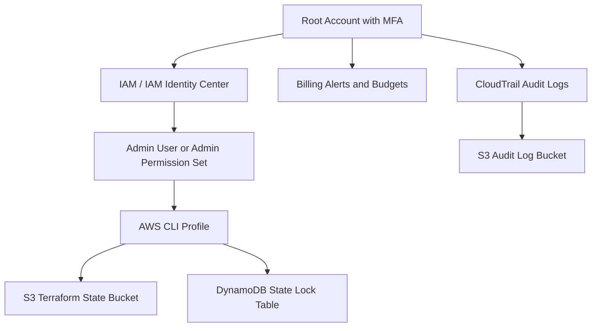

# AWS Account, IAM, Billing, MFA, CLI, And Production Foundation

## Phase 1: What Are We Building?

We are building the secure base of an AWS environment:

1. AWS account.
2. Root account MFA.
3. Admin IAM user or Identity Center admin access.
4. Billing alerts.
5. AWS CLI configuration.
6. CloudTrail audit logging.
7. S3 bucket for Terraform state.
8. DynamoDB table for Terraform locking.
9. Cost controls and tagging standards.

## Phase 2: Why Does It Exist?

Cloud projects fail early when the foundation is weak. A production AWS account needs security, billing visibility, audit logging, and repeatable infrastructure storage before applications are deployed.

## Phase 3: Real World Use Case

A company is about to deploy a Kubernetes platform, databases, container registry, CI/CD, and observability. Before that, engineers must know:

1. Who can access AWS.
2. How changes are audited.
3. Where Terraform state is stored.
4. When spending is too high.
5. How credentials are protected.

## Phase 4: Architecture Diagram



## Phase 5: Prerequisites

You need:

1. Email address.
2. Mobile phone.
3. Debit or credit card.
4. Browser.
5. Authentication app such as Microsoft Authenticator, Google Authenticator, 1Password, or Authy.

## Phase 6: Create AWS Account With Explicit Console Steps

### Step 1: Open AWS

Open:

```text
https://aws.amazon.com
```

What you are doing:
You are opening the public AWS website.

Expected result:
The AWS home page opens.

### Step 2: Start Account Creation

1. Click `Create an AWS Account`.
2. Enter your email address.
3. Enter an AWS account name, for example `prod-engineering-learning`.
4. Click `Verify email address`.
5. Open your email inbox.
6. Copy the verification code.
7. Paste the verification code into the AWS page.
8. Click `Verify`.

Possible error:
The code expires.

Fix:
Click `Resend code`, then use the newest code.

### Step 3: Create Root Password

1. Enter a strong password.
2. Use at least 16 characters.
3. Include uppercase, lowercase, numbers, and symbols.
4. Store it in a password manager.
5. Click `Continue`.

Why:
The root account can close the account, change billing, and override everything. It must be protected.

### Step 4: Add Contact Information

1. Choose account type.
2. For learning, choose `Personal`.
3. Enter full name.
4. Enter phone number.
5. Enter country.
6. Enter address.
7. Accept AWS customer agreement.
8. Click `Continue`.

### Step 5: Add Payment Method

1. Enter card number.
2. Enter expiration date.
3. Enter cardholder name.
4. Enter billing address.
5. Click `Verify and Continue`.

Possible error:
Card verification fails.

Fix:
1. Confirm international payments are enabled.
2. Confirm billing address matches the bank.
3. Try another card if required.

### Step 6: Verify Phone Number

1. Choose SMS or voice call.
2. Enter the verification code.
3. Click `Continue`.

### Step 7: Choose Support Plan

1. Select `Basic support - Free`.
2. Click `Complete sign up`.

### Step 8: Log In To AWS Console

Open:

```text
https://console.aws.amazon.com
```

1. Choose `Root user`.
2. Enter root email.
3. Enter password.
4. Click `Sign in`.

## Phase 7: Secure Root Account

### Step 1: Open Security Credentials

1. In the AWS Console top-right corner, click the account name.
2. Click `Security credentials`.

### Step 2: Enable MFA

1. Find `Multi-factor authentication`.
2. Click `Assign MFA device`.
3. Enter device name, for example `root-phone-authenticator`.
4. Choose `Authenticator app`.
5. Click `Next`.
6. Open your authenticator app.
7. Scan the QR code.
8. Enter the first MFA code.
9. Wait for the code to rotate.
10. Enter the second MFA code.
11. Click `Add MFA`.

Expected result:
Root user now shows an assigned MFA device.

Debugging:
If AWS says the MFA code is invalid:

1. Check your phone time is automatic.
2. Delete the partially added MFA entry from the app.
3. Start the MFA setup again.

## Phase 8: Create Admin Access

AWS recommends IAM Identity Center for workforce access. For beginner local CLI practice, you may also create an IAM admin user. Use Identity Center for real teams.

### Option A: IAM Identity Center Admin

1. Open AWS Console.
2. Search for `IAM Identity Center`.
3. Click `Enable`.
4. Choose `Enable with AWS Organizations`.
5. Open `Users`.
6. Click `Add user`.
7. Enter username, for example `admin`.
8. Enter email.
9. Enter first name and last name.
10. Click `Next`.
11. Open `Groups`.
12. Create group `Administrators`.
13. Add the user to `Administrators`.
14. Open `AWS accounts`.
15. Select your AWS account.
16. Click `Assign users or groups`.
17. Choose `Administrators`.
18. Choose permission set `AdministratorAccess`.
19. Click `Submit`.

Expected result:
The user receives an email invitation.

### Option B: IAM Admin User For CLI Learning

1. Open AWS Console.
2. Search for `IAM`.
3. Click `Users`.
4. Click `Create user`.
5. Enter username `admin-cli`.
6. Select `Provide user access to the AWS Management Console` only if you need console login.
7. Click `Next`.
8. Choose `Attach policies directly`.
9. Search `AdministratorAccess`.
10. Select `AdministratorAccess`.
11. Click `Next`.
12. Click `Create user`.
13. Open the created user.
14. Click `Security credentials`.
15. Click `Create access key`.
16. Choose `Command Line Interface`.
17. Confirm you understand the recommendation.
18. Click `Next`.
19. Add description `local-dev-cli`.
20. Click `Create access key`.
21. Download the `.csv` file.
22. Store it in a password manager.

Security warning:
Never commit access keys to GitHub.

## Phase 9: Enable Billing Alerts And Budget

### Step 1: Activate Billing Alerts

1. Open AWS Console.
2. Search for `Billing and Cost Management`.
3. Click `Billing preferences`.
4. Enable `Receive AWS Free Tier alerts`.
5. Enter your email.
6. Enable `Receive Billing Alerts`.
7. Click `Save preferences`.

### Step 2: Create Budget

1. Open `Budgets`.
2. Click `Create budget`.
3. Choose `Use a template`.
4. Select `Monthly cost budget`.
5. Budget name: `monthly-learning-budget`.
6. Budget amount: `10 USD` for learning or your chosen limit.
7. Email recipients: enter your email.
8. Click `Create budget`.

Expected result:
AWS emails you when cost crosses budget thresholds.

## Phase 10: Install AWS CLI

### Windows

Open PowerShell:

```powershell
winget install Amazon.AWSCLI
```

Purpose:
Installs the AWS CLI.

Why it exists:
The CLI lets you automate AWS tasks and run Terraform, Kubernetes, and deployment workflows from your terminal.

Expected output:

```text
Successfully installed
```

Common error:

```text
No package found
```

Fix:

```powershell
winget search AWSCLI
```

Then install the exact package name shown.

### macOS

```bash
brew install awscli
```

### Linux

```bash
curl "https://awscli.amazonaws.com/awscli-exe-linux-x86_64.zip" -o "awscliv2.zip"
unzip awscliv2.zip
sudo ./aws/install
```

## Phase 11: Configure AWS CLI

```bash
aws configure --profile learning-admin
```

Purpose:
Stores access key, secret key, default region, and output format in your local AWS configuration.

Why it exists:
Commands need credentials and a default region.

Enter:

```text
AWS Access Key ID: your-access-key
AWS Secret Access Key: your-secret-key
Default region name: us-east-1
Default output format: json
```

Expected test:

```bash
aws sts get-caller-identity --profile learning-admin
```

Expected output:

```json
{
  "UserId": "AIDA...",
  "Account": "123456789012",
  "Arn": "arn:aws:iam::123456789012:user/admin-cli"
}
```

Common error:

```text
Unable to locate credentials
```

Fix:

```bash
aws configure list --profile learning-admin
```

Confirm access key and region are set.

## Phase 12: Create Terraform State Backend

Replace `123456789012` with your AWS account ID.

```bash
aws s3api create-bucket \
  --bucket learning-terraform-state-123456789012 \
  --region us-east-1 \
  --profile learning-admin
```

Purpose:
Creates an S3 bucket to store Terraform state.

Why it exists:
Terraform state records what infrastructure exists. Teams need a shared remote state location.

Expected output:

```json
{
  "Location": "/learning-terraform-state-123456789012"
}
```

Common error:

```text
BucketAlreadyExists
```

Fix:
S3 bucket names are globally unique. Add your initials or another suffix.

Enable encryption:

```bash
aws s3api put-bucket-encryption \
  --bucket learning-terraform-state-123456789012 \
  --server-side-encryption-configuration '{"Rules":[{"ApplyServerSideEncryptionByDefault":{"SSEAlgorithm":"AES256"}}]}' \
  --profile learning-admin
```

Enable versioning:

```bash
aws s3api put-bucket-versioning \
  --bucket learning-terraform-state-123456789012 \
  --versioning-configuration Status=Enabled \
  --profile learning-admin
```

Create lock table:

```bash
aws dynamodb create-table \
  --table-name terraform-locks \
  --attribute-definitions AttributeName=LockID,AttributeType=S \
  --key-schema AttributeName=LockID,KeyType=HASH \
  --billing-mode PAY_PER_REQUEST \
  --region us-east-1 \
  --profile learning-admin
```

Purpose:
Creates a DynamoDB table to prevent two engineers from changing the same infrastructure state at the same time.

Expected output:

```json
{
  "TableDescription": {
    "TableName": "terraform-locks",
    "TableStatus": "CREATING"
  }
}
```

Verify:

```bash
aws dynamodb describe-table \
  --table-name terraform-locks \
  --region us-east-1 \
  --profile learning-admin
```

## Phase 13: Enable CloudTrail

### Console Steps

1. Open AWS Console.
2. Search for `CloudTrail`.
3. Click `Trails`.
4. Click `Create trail`.
5. Trail name: `account-audit-trail`.
6. Choose `Create new S3 bucket`.
7. Bucket name: `learning-cloudtrail-logs-123456789012`.
8. Enable log file SSE-KMS encryption if you are comfortable managing KMS keys.
9. Keep management events enabled.
10. Click `Next`.
11. Keep `Read` and `Write` events selected.
12. Click `Next`.
13. Click `Create trail`.

Why:
CloudTrail records who did what in AWS.

Debugging:
If logs do not appear immediately, wait 10 to 15 minutes. CloudTrail delivery is not instant.

## Phase 14: Production Hardening Checklist

1. Root account has MFA.
2. Root account is not used for daily work.
3. Admin access is assigned through IAM Identity Center where possible.
4. CLI keys are stored in a password manager.
5. Billing alerts are enabled.
6. Monthly budget is configured.
7. CloudTrail is enabled.
8. Terraform state bucket has encryption and versioning.
9. Terraform lock table exists.
10. Every resource will use tags:

```text
Project=production-engineering-masterclass
Environment=dev
Owner=your-name
CostCenter=learning
ManagedBy=terraform
```

## Interview Questions

1. Why should root account access be avoided?
2. What does MFA protect against?
3. Why does Terraform need remote state?
4. Why is state locking important?
5. What does CloudTrail record?
6. What is the difference between IAM users and IAM Identity Center users?
7. Why should production databases not be public?
8. What are AWS budgets used for?

## Exercises

1. Create an AWS budget for 5 USD.
2. Run `aws sts get-caller-identity`.
3. Create an S3 bucket for Terraform state.
4. Enable versioning on the bucket.
5. Create the DynamoDB lock table.
6. Enable CloudTrail.

## Solutions

Use:

```bash
aws sts get-caller-identity --profile learning-admin
aws s3api get-bucket-versioning --bucket learning-terraform-state-123456789012 --profile learning-admin
aws dynamodb describe-table --table-name terraform-locks --profile learning-admin
```

Success means:

1. AWS credentials work.
2. Terraform state bucket exists.
3. Terraform lock table exists.
4. Account activity is auditable.

