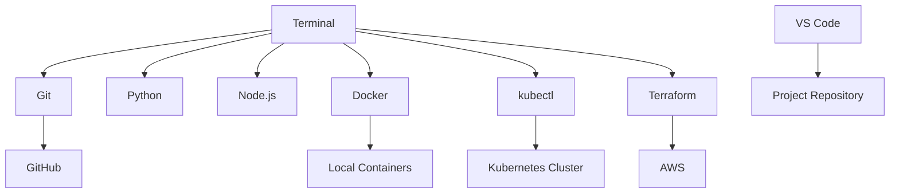

# Workstation, Terminal, Linux Basics, Git, VS Code, Python, Node, Docker, kubectl, Terraform

## Phase 1: What Are We Building?

We are building a local engineering workstation that can:

1. Write code.
2. Run commands.
3. Use Git and GitHub.
4. Build Docker containers.
5. Run Kubernetes commands.
6. Deploy Terraform infrastructure.
7. Debug applications locally.

## Phase 2: Why Does It Exist?

Every production engineer needs a reliable local environment. If your workstation is inconsistent, every later deployment becomes harder to debug.

## Phase 3: Real World Use Case

You join a platform engineering team. On day one, you must clone a repository, run the app, build a Docker image, run tests, deploy to Kubernetes, and inspect logs. This workstation setup gives you that capability.

## Phase 4: Architecture Diagram



## Phase 5: Prerequisites

You need administrator access on your computer.

## Phase 6: Install Tools On Windows

Open PowerShell as your normal user unless a command says administrator.

### Step 1: Install Git

```powershell
winget install Git.Git
```

Purpose:
Installs Git.

Why it exists:
Git tracks source code changes and allows teams to collaborate through GitHub.

Expected output:

```text
Successfully installed
```

Verify:

```powershell
git --version
```

Expected output:

```text
git version 2.x.x
```

Common error:

```text
git is not recognized
```

Fix:
Close PowerShell, open a new PowerShell window, and run `git --version` again.

### Step 2: Install VS Code

```powershell
winget install Microsoft.VisualStudioCode
```

Verify:

```powershell
code --version
```

If `code` is not recognized:

1. Open VS Code.
2. Press `Ctrl+Shift+P`.
3. Search `Shell Command`.
4. Choose `Install code command in PATH` if shown.
5. Restart terminal.

### Step 3: Install Python

```powershell
winget install Python.Python.3.12
```

Verify:

```powershell
python --version
pip --version
```

Expected output:

```text
Python 3.12.x
pip 24.x
```

### Step 4: Install Node.js

```powershell
winget install OpenJS.NodeJS.LTS
```

Verify:

```powershell
node --version
npm --version
```

Expected output:

```text
v22.x.x
10.x.x
```

### Step 5: Install Docker Desktop

```powershell
winget install Docker.DockerDesktop
```

Then:

1. Open Docker Desktop.
2. Accept terms.
3. Enable WSL 2 backend when prompted.
4. Wait until Docker says `Docker Desktop is running`.

Verify:

```powershell
docker version
docker run hello-world
```

Expected output:

```text
Hello from Docker!
```

Common error:

```text
Cannot connect to the Docker daemon
```

Fix:
Start Docker Desktop and wait until it is fully running.

### Step 6: Install kubectl

```powershell
winget install Kubernetes.kubectl
```

Verify:

```powershell
kubectl version --client
```

Expected output:

```text
Client Version: v1.x.x
```

### Step 7: Install Terraform

```powershell
winget install Hashicorp.Terraform
```

Verify:

```powershell
terraform version
```

Expected output:

```text
Terraform v1.x.x
```

## Phase 7: Install Tools On macOS

Install Homebrew:

```bash
/bin/bash -c "$(curl -fsSL https://raw.githubusercontent.com/Homebrew/install/HEAD/install.sh)"
```

Install tools:

```bash
brew install git python node terraform kubectl
brew install --cask visual-studio-code docker
```

Open Docker Desktop:

```bash
open -a Docker
```

Verify:

```bash
git --version
python3 --version
node --version
npm --version
docker version
kubectl version --client
terraform version
```

## Phase 8: Install Tools On Ubuntu Linux

Update packages:

```bash
sudo apt update
sudo apt install -y git curl unzip ca-certificates gnupg python3 python3-pip nodejs npm
```

Install Docker:

```bash
sudo install -m 0755 -d /etc/apt/keyrings
curl -fsSL https://download.docker.com/linux/ubuntu/gpg | sudo gpg --dearmor -o /etc/apt/keyrings/docker.gpg
sudo chmod a+r /etc/apt/keyrings/docker.gpg
echo "deb [arch=$(dpkg --print-architecture) signed-by=/etc/apt/keyrings/docker.gpg] https://download.docker.com/linux/ubuntu $(. /etc/os-release && echo "$VERSION_CODENAME") stable" | sudo tee /etc/apt/sources.list.d/docker.list > /dev/null
sudo apt update
sudo apt install -y docker-ce docker-ce-cli containerd.io docker-buildx-plugin docker-compose-plugin
sudo usermod -aG docker $USER
```

Purpose:
Installs Docker Engine and allows your user to run Docker.

Expected output:
Docker packages install successfully.

Common error:

```text
permission denied while trying to connect to the Docker daemon socket
```

Fix:

1. Run `sudo usermod -aG docker $USER`.
2. Log out.
3. Log back in.

Install Terraform:

```bash
wget -O- https://apt.releases.hashicorp.com/gpg | sudo gpg --dearmor -o /usr/share/keyrings/hashicorp-archive-keyring.gpg
echo "deb [signed-by=/usr/share/keyrings/hashicorp-archive-keyring.gpg] https://apt.releases.hashicorp.com $(lsb_release -cs) main" | sudo tee /etc/apt/sources.list.d/hashicorp.list
sudo apt update
sudo apt install -y terraform
```

Install kubectl:

```bash
curl -LO "https://dl.k8s.io/release/$(curl -L -s https://dl.k8s.io/release/stable.txt)/bin/linux/amd64/kubectl"
sudo install -o root -g root -m 0755 kubectl /usr/local/bin/kubectl
```

## Phase 9: Configure Git

```bash
git config --global user.name "Your Name"
git config --global user.email "you@example.com"
git config --global init.defaultBranch main
git config --global pull.rebase false
```

Purpose:
Stores your Git identity and default behavior.

Why it exists:
Every commit records who made it.

Verify:

```bash
git config --global --list
```

Expected output:

```text
user.name=Your Name
user.email=you@example.com
init.defaultbranch=main
pull.rebase=false
```

## Phase 10: Create GitHub Repository

### Step 1: Open GitHub

Open:

```text
https://github.com
```

### Step 2: Sign In Or Sign Up

1. Click `Sign in` if you have an account.
2. Click `Sign up` if you do not.
3. Verify email if prompted.
4. Add MFA in GitHub account security settings.

### Step 3: Create Repository

1. Click `+` in the top-right corner.
2. Click `New repository`.
3. Repository name: `production-engineering-masterclass`.
4. Visibility: `Private` for practice, `Public` only if no secrets exist.
5. Do not add a README from GitHub because local Git will create one.
6. Click `Create repository`.

## Phase 11: Linux Commands You Must Know

Print current directory:

```bash
pwd
```

List files:

```bash
ls -la
```

Create directory:

```bash
mkdir app
```

Change directory:

```bash
cd app
```

Create empty file:

```bash
touch README.md
```

Read file:

```bash
cat README.md
```

Search files:

```bash
find . -name "*.py"
```

Search text:

```bash
grep -R "DATABASE_URL" .
```

Check ports:

```bash
netstat -ano
```

Windows PowerShell equivalent for port 8000:

```powershell
Get-NetTCPConnection -LocalPort 8000
```

## Phase 12: Create A First Real Repository

```bash
mkdir production-engineering-masterclass
cd production-engineering-masterclass
git init
```

Create `README.md`:

```markdown
# Production Engineering Masterclass

This repository contains real applications, infrastructure, CI/CD, monitoring, security, and deployment examples.
```

Stage and commit:

```bash
git add README.md
git commit -m "Create production engineering repository"
```

Purpose:
Creates the first versioned file.

Expected output:

```text
[main abc1234] Create production engineering repository
 1 file changed
```

Connect to GitHub:

```bash
git remote add origin https://github.com/YOUR_USERNAME/production-engineering-masterclass.git
git push -u origin main
```

Common error:

```text
Authentication failed
```

Fix:

1. Use GitHub browser login when prompted.
2. Or create a Personal Access Token.
3. Use the token as the password.

## Phase 13: VS Code Extensions

Install from VS Code Extensions panel:

1. Python.
2. Docker.
3. Kubernetes.
4. Terraform.
5. YAML.
6. GitLens.
7. ESLint.
8. Prettier.

Command line install:

```bash
code --install-extension ms-python.python
code --install-extension ms-azuretools.vscode-docker
code --install-extension ms-kubernetes-tools.vscode-kubernetes-tools
code --install-extension hashicorp.terraform
code --install-extension redhat.vscode-yaml
code --install-extension eamodio.gitlens
code --install-extension dbaeumer.vscode-eslint
code --install-extension esbenp.prettier-vscode
```

## Phase 14: Workstation Verification Script

Create `verify-workstation.sh`:

```bash
#!/usr/bin/env bash
set -euo pipefail

echo "Checking Git"
git --version

echo "Checking Python"
python3 --version || python --version

echo "Checking Node"
node --version
npm --version

echo "Checking Docker"
docker version

echo "Checking kubectl"
kubectl version --client

echo "Checking Terraform"
terraform version

echo "Workstation verification complete"
```

Run:

```bash
chmod +x verify-workstation.sh
./verify-workstation.sh
```

Windows PowerShell version `verify-workstation.ps1`:

```powershell
$ErrorActionPreference = "Stop"

Write-Host "Checking Git"
git --version

Write-Host "Checking Python"
python --version

Write-Host "Checking Node"
node --version
npm --version

Write-Host "Checking Docker"
docker version

Write-Host "Checking kubectl"
kubectl version --client

Write-Host "Checking Terraform"
terraform version

Write-Host "Workstation verification complete"
```

Run:

```powershell
powershell -ExecutionPolicy Bypass -File .\verify-workstation.ps1
```

## Debugging

Problem:
Command is not recognized.

Fix:

1. Confirm the tool is installed.
2. Close and reopen terminal.
3. Check PATH.
4. Reinstall the tool if needed.

Problem:
Docker commands fail.

Fix:

1. Start Docker Desktop.
2. Wait for engine startup.
3. Run `docker version`.
4. Run `docker run hello-world`.

Problem:
GitHub push fails.

Fix:

1. Confirm remote URL with `git remote -v`.
2. Confirm GitHub login.
3. Use HTTPS browser authentication or SSH keys.

## Security

1. Enable MFA on GitHub.
2. Never commit `.env` files.
3. Use `.gitignore`.
4. Store tokens in a password manager.
5. Rotate leaked tokens immediately.

## Scaling The Workstation

As projects grow:

1. Use 16 GB RAM minimum.
2. Use SSD storage.
3. Allocate enough memory to Docker Desktop.
4. Use WSL 2 on Windows for Linux-like development.
5. Use Dev Containers for consistent team environments.

## Cost Optimization

Local development saves cloud cost. Run containers locally before deploying to AWS.

## Enterprise Architecture

Enterprise teams use:

1. Standard workstation bootstrap scripts.
2. Device management.
3. SSO.
4. Encrypted disks.
5. Endpoint protection.
6. Approved development containers.

## Interview Questions

1. What problem does Git solve?
2. What is the difference between Git and GitHub?
3. Why do containers help local development?
4. What is kubectl used for?
5. What does Terraform manage?
6. Why should secrets not be committed?

## Exercises

1. Install all tools.
2. Configure Git.
3. Create a GitHub repository.
4. Push a README.
5. Run Docker hello-world.
6. Run the verification script.

## Solutions

Your workstation is ready when these commands succeed:

```bash
git --version
python --version || python3 --version
node --version
npm --version
docker run hello-world
kubectl version --client
terraform version
```

