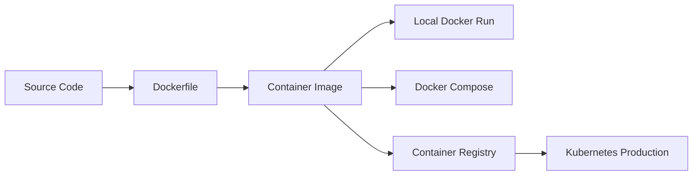

# Docker From Zero To Production: Python, Node, FastAPI, Django, React, And Microservices

## Phase 1: What Are We Building?

We are building six Docker projects:

1. Simple Python CLI app.
2. Simple Node.js API.
3. FastAPI API.
4. Django app.
5. React app served by Nginx.
6. Multi-service platform with API, worker, PostgreSQL, Redis, and Nginx.

## Phase 2: Why Does Docker Exist?

Docker packages an application with its runtime, dependencies, operating-system libraries, environment variables, and startup command. This makes software run consistently on a developer laptop, CI server, test server, and production cluster.

## Phase 3: Real World Use Case

A company wants every engineer to run the same app locally, every CI job to build the same artifact, and production to deploy the exact image that passed tests.

## Phase 4: Architecture Diagram



## Phase 5: Prerequisites

You need Docker installed and running.

Verify:

```bash
docker version
docker compose version
docker run hello-world
```

## Phase 6: Docker Internals

Important parts:

1. Dockerfile: instructions to build an image.
2. Image: immutable package created from a Dockerfile.
3. Container: running process created from an image.
4. Layer: cached filesystem change created by Dockerfile instructions.
5. Registry: remote image storage such as Docker Hub, GitHub Container Registry, or Amazon ECR.
6. Network: virtual network connecting containers.
7. Volume: persistent storage mounted into containers.

## Phase 7: Project 1 - Simple Python App

### Folder Structure

```text
docker-python-app/
  app.py
  requirements.txt
  Dockerfile
  .dockerignore
```

### app.py

```python
import os
from datetime import datetime, timezone


def main() -> None:
    name = os.getenv("APP_NAME", "docker-python-app")
    now = datetime.now(timezone.utc).isoformat()
    print(f"{name} started at {now}")
    print("Docker is running Python consistently.")


if __name__ == "__main__":
    main()
```

Line explanation:

1. `import os` reads environment variables.
2. `datetime` creates a timestamp.
3. `main()` contains the application behavior.
4. `os.getenv` reads `APP_NAME`; if missing, it uses a default.
5. `if __name__ == "__main__"` runs the app only when the file is executed directly.

### requirements.txt

```text
```

This file is intentionally empty because the first app uses only the Python standard library.

### Dockerfile

```dockerfile
FROM python:3.12-slim

WORKDIR /app

COPY requirements.txt .
RUN pip install --no-cache-dir -r requirements.txt

COPY app.py .

USER 1000

CMD ["python", "app.py"]
```

Line explanation:

1. `FROM python:3.12-slim` uses an official small Python base image.
2. `WORKDIR /app` sets the working directory inside the image.
3. `COPY requirements.txt .` copies dependency metadata first for better caching.
4. `RUN pip install...` installs Python dependencies.
5. `COPY app.py .` copies application code.
6. `USER 1000` avoids running as root.
7. `CMD` sets the default container startup command.

### .dockerignore

```text
.git
__pycache__
*.pyc
.venv
```

### Build

```bash
docker build -t docker-python-app:1.0 .
```

Purpose:
Builds a container image.

Expected output:

```text
Successfully tagged docker-python-app:1.0
```

Common error:

```text
failed to read dockerfile
```

Fix:
Run the command from the folder that contains `Dockerfile`.

### Run

```bash
docker run --rm -e APP_NAME=learning-python docker-python-app:1.0
```

Expected output:

```text
learning-python started at 2026-06-11T...
Docker is running Python consistently.
```

## Phase 8: Project 2 - Node.js API

### Folder Structure

```text
docker-node-api/
  package.json
  server.js
  Dockerfile
  .dockerignore
```

### package.json

```json
{
  "name": "docker-node-api",
  "version": "1.0.0",
  "type": "module",
  "scripts": {
    "start": "node server.js"
  },
  "dependencies": {
    "express": "4.19.2"
  }
}
```

### server.js

```javascript
import express from "express";

const app = express();
const port = Number(process.env.PORT || 3000);

app.get("/health", (req, res) => {
  res.json({ status: "ok" });
});

app.get("/", (req, res) => {
  res.json({
    service: "docker-node-api",
    message: "Node.js is running inside Docker"
  });
});

app.listen(port, "0.0.0.0", () => {
  console.log(`docker-node-api listening on ${port}`);
});
```

### Dockerfile

```dockerfile
FROM node:22-alpine

WORKDIR /app

COPY package*.json ./
RUN npm ci --omit=dev

COPY server.js .

USER node

EXPOSE 3000
CMD ["npm", "start"]
```

Build and run:

```bash
docker build -t docker-node-api:1.0 .
docker run --rm -p 3000:3000 docker-node-api:1.0
```

Test:

```bash
curl http://localhost:3000/health
curl http://localhost:3000/
```

Expected output:

```json
{"status":"ok"}
```

## Phase 9: Project 3 - FastAPI App

### Folder Structure

```text
docker-fastapi/
  app/
    main.py
  requirements.txt
  Dockerfile
  docker-compose.yml
```

### app/main.py

```python
from fastapi import FastAPI
from pydantic import BaseModel

app = FastAPI(title="Docker FastAPI")


class Message(BaseModel):
    text: str


@app.get("/health")
def health() -> dict[str, str]:
    return {"status": "ok"}


@app.post("/messages")
def create_message(message: Message) -> dict[str, str]:
    return {"received": message.text}
```

### requirements.txt

```text
fastapi==0.115.6
uvicorn[standard]==0.32.1
pydantic==2.10.3
```

### Dockerfile

```dockerfile
FROM python:3.12-slim

ENV PYTHONDONTWRITEBYTECODE=1
ENV PYTHONUNBUFFERED=1

WORKDIR /app

COPY requirements.txt .
RUN pip install --no-cache-dir -r requirements.txt

COPY app ./app

RUN adduser --disabled-password --gecos "" appuser
USER appuser

EXPOSE 8000

CMD ["uvicorn", "app.main:app", "--host", "0.0.0.0", "--port", "8000"]
```

### docker-compose.yml

```yaml
services:
  api:
    build: .
    ports:
      - "8000:8000"
    environment:
      LOG_LEVEL: info
```

Run:

```bash
docker compose up --build
```

Test:

```bash
curl http://localhost:8000/health
curl -X POST http://localhost:8000/messages \
  -H "Content-Type: application/json" \
  -d '{"text":"hello"}'
```

Common error:

```text
Address already in use
```

Fix:

```bash
docker ps
docker stop CONTAINER_ID
```

Or change the left port in Compose from `8000:8000` to `8001:8000`.

## Phase 10: Project 4 - Django App

### Folder Structure

```text
docker-django/
  manage.py
  requirements.txt
  Dockerfile
  docker-compose.yml
  config/
    __init__.py
    settings.py
    urls.py
    wsgi.py
```

### requirements.txt

```text
Django==5.1.4
gunicorn==23.0.0
psycopg[binary]==3.2.3
```

### config/settings.py

```python
import os
from pathlib import Path

BASE_DIR = Path(__file__).resolve().parent.parent

SECRET_KEY = os.getenv("DJANGO_SECRET_KEY", "dev-only-change-me")
DEBUG = os.getenv("DJANGO_DEBUG", "false").lower() == "true"
ALLOWED_HOSTS = os.getenv("DJANGO_ALLOWED_HOSTS", "localhost,127.0.0.1").split(",")

INSTALLED_APPS = [
    "django.contrib.admin",
    "django.contrib.auth",
    "django.contrib.contenttypes",
    "django.contrib.sessions",
    "django.contrib.messages",
    "django.contrib.staticfiles",
]

MIDDLEWARE = [
    "django.middleware.security.SecurityMiddleware",
    "django.contrib.sessions.middleware.SessionMiddleware",
    "django.middleware.common.CommonMiddleware",
    "django.middleware.csrf.CsrfViewMiddleware",
    "django.contrib.auth.middleware.AuthenticationMiddleware",
    "django.contrib.messages.middleware.MessageMiddleware",
    "django.middleware.clickjacking.XFrameOptionsMiddleware",
]

ROOT_URLCONF = "config.urls"
WSGI_APPLICATION = "config.wsgi.application"

DATABASES = {
    "default": {
        "ENGINE": "django.db.backends.postgresql",
        "NAME": os.getenv("POSTGRES_DB", "app"),
        "USER": os.getenv("POSTGRES_USER", "app"),
        "PASSWORD": os.getenv("POSTGRES_PASSWORD", "app"),
        "HOST": os.getenv("POSTGRES_HOST", "db"),
        "PORT": os.getenv("POSTGRES_PORT", "5432"),
    }
}

LANGUAGE_CODE = "en-us"
TIME_ZONE = "UTC"
USE_I18N = True
USE_TZ = True
STATIC_URL = "static/"
DEFAULT_AUTO_FIELD = "django.db.models.BigAutoField"
```

### config/urls.py

```python
from django.http import JsonResponse
from django.urls import path


def health(request):
    return JsonResponse({"status": "ok"})


urlpatterns = [
    path("health/", health),
]
```

### config/wsgi.py

```python
import os
from django.core.wsgi import get_wsgi_application

os.environ.setdefault("DJANGO_SETTINGS_MODULE", "config.settings")
application = get_wsgi_application()
```

### manage.py

```python
#!/usr/bin/env python
import os
import sys


def main():
    os.environ.setdefault("DJANGO_SETTINGS_MODULE", "config.settings")
    from django.core.management import execute_from_command_line
    execute_from_command_line(sys.argv)


if __name__ == "__main__":
    main()
```

### Dockerfile

```dockerfile
FROM python:3.12-slim

ENV PYTHONDONTWRITEBYTECODE=1
ENV PYTHONUNBUFFERED=1

WORKDIR /app

RUN apt-get update \
    && apt-get install -y --no-install-recommends libpq5 \
    && rm -rf /var/lib/apt/lists/*

COPY requirements.txt .
RUN pip install --no-cache-dir -r requirements.txt

COPY . .

RUN adduser --disabled-password --gecos "" appuser
USER appuser

EXPOSE 8000

CMD ["gunicorn", "config.wsgi:application", "--bind", "0.0.0.0:8000", "--workers", "2"]
```

### docker-compose.yml

```yaml
services:
  web:
    build: .
    ports:
      - "8000:8000"
    environment:
      DJANGO_SECRET_KEY: "change-me-in-production"
      DJANGO_DEBUG: "false"
      DJANGO_ALLOWED_HOSTS: "localhost,127.0.0.1"
      POSTGRES_DB: app
      POSTGRES_USER: app
      POSTGRES_PASSWORD: app
      POSTGRES_HOST: db
    depends_on:
      - db

  db:
    image: postgres:16-alpine
    environment:
      POSTGRES_DB: app
      POSTGRES_USER: app
      POSTGRES_PASSWORD: app
    volumes:
      - postgres_data:/var/lib/postgresql/data

volumes:
  postgres_data:
```

Run:

```bash
docker compose up --build
```

Migrate:

```bash
docker compose exec web python manage.py migrate
```

Test:

```bash
curl http://localhost:8000/health/
```

## Phase 11: Project 5 - React App Served By Nginx

### Folder Structure

```text
docker-react/
  package.json
  index.html
  src/
    main.jsx
    App.jsx
  nginx.conf
  Dockerfile
```

### package.json

```json
{
  "name": "docker-react",
  "version": "1.0.0",
  "type": "module",
  "scripts": {
    "dev": "vite --host 0.0.0.0",
    "build": "vite build",
    "preview": "vite preview --host 0.0.0.0"
  },
  "dependencies": {
    "@vitejs/plugin-react": "latest",
    "vite": "latest",
    "react": "latest",
    "react-dom": "latest"
  },
  "devDependencies": {}
}
```

### src/App.jsx

```jsx
export default function App() {
  return (
    <main>
      <h1>React running from Docker and Nginx</h1>
      <p>This static frontend was built by Vite and served by Nginx.</p>
    </main>
  );
}
```

### src/main.jsx

```jsx
import React from "react";
import { createRoot } from "react-dom/client";
import App from "./App.jsx";

createRoot(document.getElementById("root")).render(<App />);
```

### index.html

```html
<!doctype html>
<html lang="en">
  <head>
    <meta charset="UTF-8" />
    <meta name="viewport" content="width=device-width, initial-scale=1.0" />
    <title>Docker React</title>
  </head>
  <body>
    <div id="root"></div>
    <script type="module" src="/src/main.jsx"></script>
  </body>
</html>
```

### nginx.conf

```nginx
server {
    listen 80;
    server_name _;

    root /usr/share/nginx/html;
    index index.html;

    location / {
        try_files $uri /index.html;
    }

    location /health {
        access_log off;
        return 200 "ok\n";
    }
}
```

### Dockerfile

```dockerfile
FROM node:22-alpine AS build

WORKDIR /app
COPY package*.json ./
RUN npm install
COPY . .
RUN npm run build

FROM nginx:1.27-alpine
COPY nginx.conf /etc/nginx/conf.d/default.conf
COPY --from=build /app/dist /usr/share/nginx/html
EXPOSE 80
CMD ["nginx", "-g", "daemon off;"]
```

Build and run:

```bash
docker build -t docker-react:1.0 .
docker run --rm -p 8080:80 docker-react:1.0
```

Test:

```bash
curl http://localhost:8080/health
```

## Phase 12: Project 6 - Microservices Compose Platform

### Folder Structure

```text
compose-platform/
  docker-compose.yml
  api/
    app.py
    requirements.txt
    Dockerfile
  worker/
    worker.py
    requirements.txt
    Dockerfile
  nginx/
    nginx.conf
```

### api/app.py

```python
import os
import redis
from fastapi import FastAPI

app = FastAPI(title="Compose Platform API")
cache = redis.Redis(host=os.getenv("REDIS_HOST", "redis"), port=6379, decode_responses=True)


@app.get("/health")
def health():
    return {"status": "ok"}


@app.post("/visits")
def visits():
    count = cache.incr("visits")
    return {"visits": count}
```

### api/requirements.txt

```text
fastapi==0.115.6
uvicorn[standard]==0.32.1
redis==5.2.1
```

### api/Dockerfile

```dockerfile
FROM python:3.12-slim
WORKDIR /app
COPY requirements.txt .
RUN pip install --no-cache-dir -r requirements.txt
COPY app.py .
RUN adduser --disabled-password --gecos "" appuser
USER appuser
EXPOSE 8000
CMD ["uvicorn", "app:app", "--host", "0.0.0.0", "--port", "8000"]
```

### worker/worker.py

```python
import os
import time
import redis

cache = redis.Redis(host=os.getenv("REDIS_HOST", "redis"), port=6379, decode_responses=True)

while True:
    visits = cache.get("visits") or "0"
    print(f"worker observed visits={visits}", flush=True)
    time.sleep(10)
```

### worker/requirements.txt

```text
redis==5.2.1
```

### worker/Dockerfile

```dockerfile
FROM python:3.12-slim
WORKDIR /app
COPY requirements.txt .
RUN pip install --no-cache-dir -r requirements.txt
COPY worker.py .
RUN adduser --disabled-password --gecos "" worker
USER worker
CMD ["python", "worker.py"]
```

### nginx/nginx.conf

```nginx
events {}

http {
    upstream api {
        server api:8000;
    }

    server {
        listen 80;

        location / {
            proxy_pass http://api;
            proxy_set_header Host $host;
            proxy_set_header X-Real-IP $remote_addr;
        }

        location /health {
            proxy_pass http://api/health;
        }
    }
}
```

### docker-compose.yml

```yaml
services:
  nginx:
    image: nginx:1.27-alpine
    ports:
      - "8080:80"
    volumes:
      - ./nginx/nginx.conf:/etc/nginx/nginx.conf:ro
    depends_on:
      - api

  api:
    build: ./api
    environment:
      REDIS_HOST: redis
    depends_on:
      - redis

  worker:
    build: ./worker
    environment:
      REDIS_HOST: redis
    depends_on:
      - redis

  redis:
    image: redis:7.4-alpine
    command: ["redis-server", "--appendonly", "yes"]
    volumes:
      - redis_data:/data

  postgres:
    image: postgres:16-alpine
    environment:
      POSTGRES_DB: platform
      POSTGRES_USER: platform
      POSTGRES_PASSWORD: platform
    volumes:
      - postgres_data:/var/lib/postgresql/data

volumes:
  redis_data:
  postgres_data:
```

Run:

```bash
docker compose up --build
```

Test:

```bash
curl http://localhost:8080/health
curl -X POST http://localhost:8080/visits
docker compose logs worker
```

Expected output:

```json
{"status":"ok"}
{"visits":1}
```

## Production Implementation

Production Docker rules:

1. Use small base images.
2. Pin image versions.
3. Run as non-root.
4. Do not bake secrets into images.
5. Use `.dockerignore`.
6. Use multi-stage builds for compiled or frontend apps.
7. Scan images.
8. Push immutable tags.
9. Use health checks.
10. Limit CPU and memory in runtime platform.

Production Dockerfile pattern:

```dockerfile
FROM python:3.12-slim

ENV PYTHONDONTWRITEBYTECODE=1
ENV PYTHONUNBUFFERED=1

WORKDIR /app

COPY requirements.txt .
RUN pip install --no-cache-dir -r requirements.txt

COPY app ./app

RUN adduser --disabled-password --gecos "" appuser
USER appuser

HEALTHCHECK --interval=30s --timeout=3s --retries=3 \
  CMD python -c "import urllib.request; urllib.request.urlopen('http://127.0.0.1:8000/health')"

EXPOSE 8000
CMD ["uvicorn", "app.main:app", "--host", "0.0.0.0", "--port", "8000"]
```

## Monitoring

Useful commands:

```bash
docker ps
docker stats
docker logs CONTAINER_ID
docker inspect CONTAINER_ID
docker compose ps
docker compose logs -f
```

Purpose:
These commands show running containers, resource usage, logs, metadata, and Compose service status.

## Debugging

Container exits immediately:

```bash
docker logs CONTAINER_ID
```

Image build fails:

```bash
docker build --no-cache -t app:debug .
```

Network failure between containers:

```bash
docker compose exec api getent hosts redis
docker compose exec api sh
```

Port conflict:

```bash
docker ps
```

Fix:
Stop the container using the port or map to a different host port.

## Security

1. Use non-root users.
2. Pin base images.
3. Scan images:

```bash
docker scout cves IMAGE_NAME
```

4. Never copy `.env` into images.
5. Use read-only root filesystem in Kubernetes when possible.

## Scaling

Docker Compose scale example:

```bash
docker compose up --scale api=3
```

This starts three API containers. In production, Kubernetes Deployments handle this pattern.

## Cost Optimization

1. Use small images to reduce registry storage and transfer.
2. Clean build cache:

```bash
docker builder prune
```

3. Remove unused images:

```bash
docker image prune
```

## Enterprise Architecture

Enterprise image pipeline:

1. Developer pushes code.
2. CI runs tests.
3. CI builds image.
4. CI scans dependencies.
5. CI scans container image.
6. CI signs image.
7. CI pushes image to registry.
8. CD deploys pinned digest to Kubernetes.

## Interview Questions

1. What is the difference between an image and a container?
2. Why should containers not run as root?
3. Why does Docker layer caching matter?
4. What does `.dockerignore` do?
5. What is a multi-stage build?
6. How do containers communicate in Docker Compose?

## Exercises

1. Build the Python app image.
2. Run the Node API.
3. Run the FastAPI Compose app.
4. Add a `/version` endpoint.
5. Scale the Compose API to 3 replicas.
6. Inspect logs and stats.

## Solutions

Use:

```bash
docker build -t docker-python-app:1.0 .
docker run --rm docker-python-app:1.0
docker compose up --build
docker compose logs -f
docker compose up --scale api=3
```

