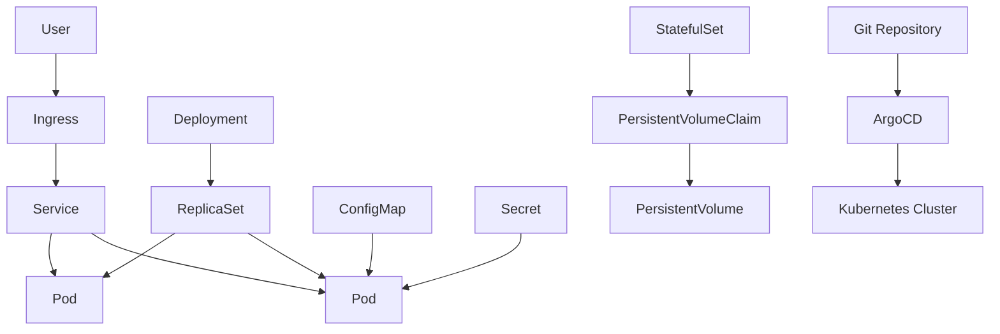

# Kubernetes From Zero To GitOps: Pod, Deployment, ReplicaSet, Service, Ingress, ConfigMap, Secret, Volume, StatefulSet, Helm, ArgoCD

## Phase 1: What Are We Building?

We are building a Kubernetes deployment path:

1. Pod.
2. Deployment.
3. ReplicaSet through Deployment.
4. Service.
5. Ingress.
6. ConfigMap.
7. Secret.
8. PersistentVolume.
9. PersistentVolumeClaim.
10. StatefulSet.
11. Helm chart.
12. ArgoCD GitOps deployment.

## Phase 2: Why Does Kubernetes Exist?

Kubernetes runs containers across machines. It handles scheduling, service discovery, restarts, scaling, rollout, rollback, configuration, secrets, volumes, and declarative deployment.

## Phase 3: Real World Use Case

A company has 30 containerized services. Running them manually with `docker run` is fragile. Kubernetes gives a standard control plane for deployment and operations.

## Phase 4: Architecture Diagram



## Phase 5: Prerequisites

You need:

1. Docker Desktop Kubernetes, Minikube, Kind, or a cloud Kubernetes cluster.
2. kubectl.
3. Helm.

Install Helm:

```bash
winget install Helm.Helm
```

macOS:

```bash
brew install helm
```

Linux:

```bash
curl https://raw.githubusercontent.com/helm/helm/main/scripts/get-helm-3 | bash
```

Verify:

```bash
kubectl version --client
helm version
```

## Phase 6: Create A Local Cluster With Kind

Install Kind:

```bash
winget install Kubernetes.kind
```

Create cluster:

```bash
kind create cluster --name learning
```

Purpose:
Creates a local Kubernetes cluster inside Docker.

Expected output:

```text
Creating cluster "learning" ...
Set kubectl context to "kind-learning"
```

Verify:

```bash
kubectl cluster-info
kubectl get nodes
```

## Phase 7: Pod

Create `01-pod.yaml`:

```yaml
apiVersion: v1
kind: Pod
metadata:
  name: hello-pod
  labels:
    app: hello
spec:
  containers:
    - name: hello
      image: nginx:1.27-alpine
      ports:
        - containerPort: 80
```

Apply:

```bash
kubectl apply -f 01-pod.yaml
kubectl get pods
kubectl describe pod hello-pod
```

Expected output:

```text
hello-pod   1/1   Running
```

Debug:

```bash
kubectl logs hello-pod
kubectl get events --sort-by=.lastTimestamp
```

## Phase 8: Deployment And ReplicaSet

Create `02-deployment.yaml`:

```yaml
apiVersion: apps/v1
kind: Deployment
metadata:
  name: hello-deployment
spec:
  replicas: 3
  selector:
    matchLabels:
      app: hello
  template:
    metadata:
      labels:
        app: hello
    spec:
      containers:
        - name: hello
          image: nginx:1.27-alpine
          ports:
            - containerPort: 80
          resources:
            requests:
              cpu: 50m
              memory: 64Mi
            limits:
              cpu: 250m
              memory: 128Mi
```

Apply:

```bash
kubectl apply -f 02-deployment.yaml
kubectl get deployments
kubectl get replicasets
kubectl get pods -l app=hello
```

Purpose:
Deployment manages ReplicaSets, and ReplicaSets keep the desired number of Pods running.

Scale:

```bash
kubectl scale deployment hello-deployment --replicas=5
```

Rollout:

```bash
kubectl set image deployment/hello-deployment hello=nginx:1.27.3-alpine
kubectl rollout status deployment/hello-deployment
kubectl rollout history deployment/hello-deployment
```

Rollback:

```bash
kubectl rollout undo deployment/hello-deployment
```

## Phase 9: Service

Create `03-service.yaml`:

```yaml
apiVersion: v1
kind: Service
metadata:
  name: hello-service
spec:
  type: ClusterIP
  selector:
    app: hello
  ports:
    - port: 80
      targetPort: 80
```

Apply:

```bash
kubectl apply -f 03-service.yaml
kubectl get service hello-service
```

Test inside cluster:

```bash
kubectl run curl --image=curlimages/curl:8.10.1 -it --rm -- sh
curl http://hello-service
```

## Phase 10: ConfigMap And Secret

Create `04-config-secret.yaml`:

```yaml
apiVersion: v1
kind: ConfigMap
metadata:
  name: app-config
data:
  APP_ENV: dev
  LOG_LEVEL: info
---
apiVersion: v1
kind: Secret
metadata:
  name: app-secret
type: Opaque
stringData:
  DATABASE_PASSWORD: change-me
---
apiVersion: apps/v1
kind: Deployment
metadata:
  name: config-demo
spec:
  replicas: 1
  selector:
    matchLabels:
      app: config-demo
  template:
    metadata:
      labels:
        app: config-demo
    spec:
      containers:
        - name: demo
          image: busybox:1.36
          command: ["sh", "-c", "env && sleep 3600"]
          envFrom:
            - configMapRef:
                name: app-config
            - secretRef:
                name: app-secret
```

Apply:

```bash
kubectl apply -f 04-config-secret.yaml
kubectl logs deploy/config-demo
```

Security:
Kubernetes Secrets are base64-encoded by default, not fully secret from cluster admins. Use cloud secret managers and encryption at rest in production.

## Phase 11: PersistentVolume And PersistentVolumeClaim

Create `05-volume.yaml`:

```yaml
apiVersion: v1
kind: PersistentVolumeClaim
metadata:
  name: data-pvc
spec:
  accessModes:
    - ReadWriteOnce
  resources:
    requests:
      storage: 1Gi
---
apiVersion: apps/v1
kind: Deployment
metadata:
  name: volume-demo
spec:
  replicas: 1
  selector:
    matchLabels:
      app: volume-demo
  template:
    metadata:
      labels:
        app: volume-demo
    spec:
      containers:
        - name: writer
          image: busybox:1.36
          command: ["sh", "-c", "while true; do date >> /data/timestamps.txt; sleep 5; done"]
          volumeMounts:
            - name: data
              mountPath: /data
      volumes:
        - name: data
          persistentVolumeClaim:
            claimName: data-pvc
```

Apply:

```bash
kubectl apply -f 05-volume.yaml
kubectl get pvc
kubectl exec deploy/volume-demo -- cat /data/timestamps.txt
```

## Phase 12: StatefulSet

Create `06-statefulset.yaml`:

```yaml
apiVersion: v1
kind: Service
metadata:
  name: redis
spec:
  clusterIP: None
  selector:
    app: redis
  ports:
    - port: 6379
---
apiVersion: apps/v1
kind: StatefulSet
metadata:
  name: redis
spec:
  serviceName: redis
  replicas: 1
  selector:
    matchLabels:
      app: redis
  template:
    metadata:
      labels:
        app: redis
    spec:
      containers:
        - name: redis
          image: redis:7.4-alpine
          ports:
            - containerPort: 6379
          volumeMounts:
            - name: data
              mountPath: /data
  volumeClaimTemplates:
    - metadata:
        name: data
      spec:
        accessModes: ["ReadWriteOnce"]
        resources:
          requests:
            storage: 1Gi
```

Apply:

```bash
kubectl apply -f 06-statefulset.yaml
kubectl get statefulsets
kubectl get pods
kubectl get pvc
```

Why StatefulSet exists:
It gives stable pod names, stable network identities, and stable storage for stateful apps.

## Phase 13: Ingress

Install NGINX ingress for Kind:

```bash
kubectl apply -f https://raw.githubusercontent.com/kubernetes/ingress-nginx/main/deploy/static/provider/kind/deploy.yaml
```

Wait:

```bash
kubectl wait --namespace ingress-nginx \
  --for=condition=ready pod \
  --selector=app.kubernetes.io/component=controller \
  --timeout=120s
```

Create `07-ingress.yaml`:

```yaml
apiVersion: networking.k8s.io/v1
kind: Ingress
metadata:
  name: hello-ingress
spec:
  ingressClassName: nginx
  rules:
    - host: hello.local
      http:
        paths:
          - path: /
            pathType: Prefix
            backend:
              service:
                name: hello-service
                port:
                  number: 80
```

Apply:

```bash
kubectl apply -f 07-ingress.yaml
kubectl get ingress
```

Add hosts entry:

```text
127.0.0.1 hello.local
```

Test:

```bash
curl http://hello.local
```

## Phase 14: Helm Chart

Create chart:

```bash
helm create orders-api
```

Important files:

```text
orders-api/
  Chart.yaml
  values.yaml
  templates/
    deployment.yaml
    service.yaml
    ingress.yaml
```

Minimal `values.yaml`:

```yaml
replicaCount: 2

image:
  repository: orders-api
  tag: "1.0"
  pullPolicy: IfNotPresent

service:
  type: ClusterIP
  port: 80

containerPort: 8000

resources:
  requests:
    cpu: 100m
    memory: 128Mi
  limits:
    cpu: 500m
    memory: 512Mi
```

Install:

```bash
helm install orders-api ./orders-api
helm list
helm upgrade orders-api ./orders-api --set replicaCount=3
helm rollback orders-api 1
```

## Phase 15: ArgoCD GitOps

Install ArgoCD:

```bash
kubectl create namespace argocd
kubectl apply -n argocd -f https://raw.githubusercontent.com/argoproj/argo-cd/stable/manifests/install.yaml
kubectl -n argocd get pods
```

Expose locally:

```bash
kubectl -n argocd port-forward svc/argocd-server 8080:443
```

Get admin password:

```bash
kubectl -n argocd get secret argocd-initial-admin-secret \
  -o jsonpath="{.data.password}" | base64 -d
```

Console steps:

1. Open `https://localhost:8080`.
2. Accept browser warning for local certificate.
3. Username: `admin`.
4. Password: use the decoded password.
5. Click `New App`.
6. Application name: `orders-api`.
7. Project: `default`.
8. Sync policy: `Manual` for learning.
9. Repository URL: your Git repo URL.
10. Revision: `main`.
11. Path: path containing Helm chart or manifests.
12. Cluster URL: `https://kubernetes.default.svc`.
13. Namespace: `orders`.
14. Click `Create`.
15. Click the app.
16. Click `Sync`.
17. Click `Synchronize`.

## Monitoring

Commands:

```bash
kubectl get pods -A
kubectl top pods -A
kubectl describe pod POD_NAME
kubectl logs POD_NAME
kubectl get events --sort-by=.lastTimestamp
```

## Debugging

Image pull error:

```bash
kubectl describe pod POD_NAME
```

Common causes:

1. Wrong image name.
2. Private registry missing pull secret.
3. Tag does not exist.

CrashLoopBackOff:

```bash
kubectl logs POD_NAME --previous
```

Pending pod:

```bash
kubectl describe pod POD_NAME
kubectl get nodes
```

Common causes:

1. Not enough CPU or memory.
2. PVC cannot bind.
3. Node selector does not match.

## Security

1. Use namespaces.
2. Use RBAC.
3. Use NetworkPolicies.
4. Use resource limits.
5. Use non-root containers.
6. Use read-only root filesystem where possible.
7. Use external secret managers.
8. Scan images.

Example secure pod context:

```yaml
securityContext:
  runAsNonRoot: true
  runAsUser: 1000
  allowPrivilegeEscalation: false
  readOnlyRootFilesystem: true
  capabilities:
    drop:
      - ALL
```

## Scaling

Manual scale:

```bash
kubectl scale deployment hello-deployment --replicas=10
```

Autoscale:

```bash
kubectl autoscale deployment hello-deployment --cpu-percent=70 --min=3 --max=20
```

## Cost Optimization

1. Set requests and limits.
2. Remove unused namespaces.
3. Use autoscaling.
4. Use spot nodes for stateless workloads.
5. Use log retention.
6. Right-size nodes.

## Enterprise Architecture

Enterprise clusters use:

1. Multiple node groups.
2. Private nodes.
3. Managed ingress.
4. External DNS.
5. Cert Manager.
6. External Secrets.
7. ArgoCD.
8. Prometheus and Grafana.
9. Central logging.
10. Policy enforcement with Kyverno or OPA Gatekeeper.

## Interview Questions

1. What is the difference between a Pod and a Deployment?
2. Why does a Service exist?
3. What is a ReplicaSet?
4. Why use ConfigMaps?
5. Why are Secrets not enough for enterprise secret management?
6. What does ArgoCD do?
7. What is GitOps?

## Exercises

1. Deploy Nginx with 3 replicas.
2. Expose it with a Service.
3. Add an Ingress.
4. Add ConfigMap environment variables.
5. Add resource limits.
6. Convert manifests to a Helm chart.
7. Deploy with ArgoCD.

## Solutions

The Kubernetes path works when:

```bash
kubectl get nodes
kubectl apply -f 02-deployment.yaml
kubectl apply -f 03-service.yaml
kubectl get pods
kubectl get svc
helm install orders-api ./orders-api
kubectl -n argocd get pods
```

