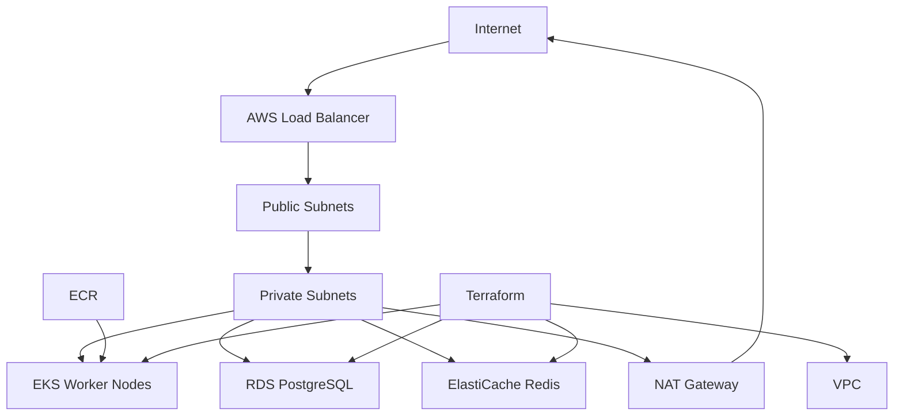

# Terraform AWS Production Infrastructure: VPC, ECR, EKS, RDS, ElastiCache, IAM, Security, State

## Phase 1: What Are We Building?

We are building production-style AWS infrastructure with Terraform:

1. Remote state backend.
2. VPC.
3. Public and private subnets.
4. Internet Gateway.
5. NAT Gateway.
6. Route tables.
7. ECR repository.
8. EKS cluster.
9. RDS PostgreSQL.
10. ElastiCache Redis.
11. IAM roles.
12. Security groups.

## Phase 2: Why Does It Exist?

Infrastructure as code makes cloud environments repeatable, reviewable, and recoverable. Terraform lets teams create the same infrastructure across dev, staging, and production.

## Phase 3: Real World Use Case

A platform team needs to deploy services to AWS. The app needs Kubernetes, database, cache, networking, security groups, and a container registry.

## Phase 4: Architecture Diagram



## Phase 5: Prerequisites

You need:

1. AWS account.
2. AWS CLI configured.
3. Terraform installed.
4. S3 Terraform state bucket.
5. DynamoDB Terraform lock table.

Verify:

```bash
aws sts get-caller-identity --profile learning-admin
terraform version
```

## Phase 6: Folder Structure

```text
terraform-aws-platform/
  backend.tf
  providers.tf
  variables.tf
  main.tf
  outputs.tf
  terraform.tfvars.example
  modules/
    network/
      main.tf
      variables.tf
      outputs.tf
    ecr/
      main.tf
      variables.tf
      outputs.tf
    database/
      main.tf
      variables.tf
      outputs.tf
```

## Phase 7: Root Terraform Files

### backend.tf

```hcl
terraform {
  backend "s3" {
    bucket         = "learning-terraform-state-123456789012"
    key            = "platform/dev/terraform.tfstate"
    region         = "us-east-1"
    dynamodb_table = "terraform-locks"
    encrypt        = true
  }
}
```

Purpose:
Stores state in S3 and uses DynamoDB locking.

### providers.tf

```hcl
terraform {
  required_version = ">= 1.6.0"

  required_providers {
    aws = {
      source  = "hashicorp/aws"
      version = "~> 5.80"
    }
  }
}

provider "aws" {
  region  = var.aws_region
  profile = var.aws_profile

  default_tags {
    tags = {
      Project     = var.project
      Environment = var.environment
      ManagedBy   = "terraform"
    }
  }
}
```

### variables.tf

```hcl
variable "aws_region" {
  type    = string
  default = "us-east-1"
}

variable "aws_profile" {
  type    = string
  default = "learning-admin"
}

variable "project" {
  type    = string
  default = "production-engineering"
}

variable "environment" {
  type    = string
  default = "dev"
}

variable "db_password" {
  type      = string
  sensitive = true
}
```

### main.tf

```hcl
module "network" {
  source      = "./modules/network"
  project     = var.project
  environment = var.environment
  vpc_cidr    = "10.20.0.0/16"
}

module "ecr" {
  source      = "./modules/ecr"
  project     = var.project
  environment = var.environment
  repositories = [
    "orders-api",
    "auth-service",
    "user-service",
    "product-service",
    "payment-service",
    "notification-service"
  ]
}

module "database" {
  source             = "./modules/database"
  project            = var.project
  environment        = var.environment
  vpc_id             = module.network.vpc_id
  private_subnet_ids = module.network.private_subnet_ids
  db_password        = var.db_password
}
```

### outputs.tf

```hcl
output "vpc_id" {
  value = module.network.vpc_id
}

output "private_subnet_ids" {
  value = module.network.private_subnet_ids
}

output "ecr_repository_urls" {
  value = module.ecr.repository_urls
}

output "rds_endpoint" {
  value = module.database.rds_endpoint
}

output "redis_endpoint" {
  value = module.database.redis_endpoint
}
```

### terraform.tfvars.example

```hcl
aws_region   = "us-east-1"
aws_profile  = "learning-admin"
project      = "production-engineering"
environment  = "dev"
db_password  = "replace-with-strong-password"
```

## Phase 8: Network Module

### modules/network/variables.tf

```hcl
variable "project" { type = string }
variable "environment" { type = string }
variable "vpc_cidr" { type = string }
```

### modules/network/main.tf

```hcl
data "aws_availability_zones" "available" {
  state = "available"
}

locals {
  name = "${var.project}-${var.environment}"
  azs  = slice(data.aws_availability_zones.available.names, 0, 2)
}

resource "aws_vpc" "this" {
  cidr_block           = var.vpc_cidr
  enable_dns_hostnames = true
  enable_dns_support   = true

  tags = {
    Name = "${local.name}-vpc"
  }
}

resource "aws_internet_gateway" "this" {
  vpc_id = aws_vpc.this.id

  tags = {
    Name = "${local.name}-igw"
  }
}

resource "aws_subnet" "public" {
  count                   = 2
  vpc_id                  = aws_vpc.this.id
  cidr_block              = cidrsubnet(var.vpc_cidr, 8, count.index)
  availability_zone       = local.azs[count.index]
  map_public_ip_on_launch = true

  tags = {
    Name = "${local.name}-public-${count.index + 1}"
    Tier = "public"
  }
}

resource "aws_subnet" "private" {
  count             = 2
  vpc_id            = aws_vpc.this.id
  cidr_block        = cidrsubnet(var.vpc_cidr, 8, count.index + 10)
  availability_zone = local.azs[count.index]

  tags = {
    Name = "${local.name}-private-${count.index + 1}"
    Tier = "private"
  }
}

resource "aws_eip" "nat" {
  domain = "vpc"

  tags = {
    Name = "${local.name}-nat-eip"
  }
}

resource "aws_nat_gateway" "this" {
  allocation_id = aws_eip.nat.id
  subnet_id     = aws_subnet.public[0].id

  tags = {
    Name = "${local.name}-nat"
  }

  depends_on = [aws_internet_gateway.this]
}

resource "aws_route_table" "public" {
  vpc_id = aws_vpc.this.id

  route {
    cidr_block = "0.0.0.0/0"
    gateway_id = aws_internet_gateway.this.id
  }

  tags = {
    Name = "${local.name}-public-rt"
  }
}

resource "aws_route_table" "private" {
  vpc_id = aws_vpc.this.id

  route {
    cidr_block     = "0.0.0.0/0"
    nat_gateway_id = aws_nat_gateway.this.id
  }

  tags = {
    Name = "${local.name}-private-rt"
  }
}

resource "aws_route_table_association" "public" {
  count          = length(aws_subnet.public)
  subnet_id      = aws_subnet.public[count.index].id
  route_table_id = aws_route_table.public.id
}

resource "aws_route_table_association" "private" {
  count          = length(aws_subnet.private)
  subnet_id      = aws_subnet.private[count.index].id
  route_table_id = aws_route_table.private.id
}
```

### modules/network/outputs.tf

```hcl
output "vpc_id" {
  value = aws_vpc.this.id
}

output "public_subnet_ids" {
  value = aws_subnet.public[*].id
}

output "private_subnet_ids" {
  value = aws_subnet.private[*].id
}
```

## Phase 9: ECR Module

### modules/ecr/variables.tf

```hcl
variable "project" { type = string }
variable "environment" { type = string }
variable "repositories" { type = list(string) }
```

### modules/ecr/main.tf

```hcl
resource "aws_ecr_repository" "this" {
  for_each = toset(var.repositories)

  name                 = "${var.project}/${var.environment}/${each.key}"
  image_tag_mutability = "IMMUTABLE"

  image_scanning_configuration {
    scan_on_push = true
  }

  encryption_configuration {
    encryption_type = "AES256"
  }
}

resource "aws_ecr_lifecycle_policy" "this" {
  for_each   = aws_ecr_repository.this
  repository = each.value.name

  policy = jsonencode({
    rules = [
      {
        rulePriority = 1
        description  = "Keep last 20 images"
        selection = {
          tagStatus   = "any"
          countType   = "imageCountMoreThan"
          countNumber = 20
        }
        action = {
          type = "expire"
        }
      }
    ]
  })
}
```

### modules/ecr/outputs.tf

```hcl
output "repository_urls" {
  value = { for name, repo in aws_ecr_repository.this : name => repo.repository_url }
}
```

## Phase 10: Database Module

### modules/database/variables.tf

```hcl
variable "project" { type = string }
variable "environment" { type = string }
variable "vpc_id" { type = string }
variable "private_subnet_ids" { type = list(string) }
variable "db_password" {
  type      = string
  sensitive = true
}
```

### modules/database/main.tf

```hcl
locals {
  name = "${var.project}-${var.environment}"
}

resource "aws_security_group" "database" {
  name        = "${local.name}-database-sg"
  description = "Database access from application subnets"
  vpc_id      = var.vpc_id

  ingress {
    description = "PostgreSQL"
    from_port   = 5432
    to_port     = 5432
    protocol    = "tcp"
    cidr_blocks = ["10.20.0.0/16"]
  }

  ingress {
    description = "Redis"
    from_port   = 6379
    to_port     = 6379
    protocol    = "tcp"
    cidr_blocks = ["10.20.0.0/16"]
  }

  egress {
    from_port   = 0
    to_port     = 0
    protocol    = "-1"
    cidr_blocks = ["0.0.0.0/0"]
  }
}

resource "aws_db_subnet_group" "this" {
  name       = "${local.name}-db-subnets"
  subnet_ids = var.private_subnet_ids
}

resource "aws_db_instance" "postgres" {
  identifier              = "${local.name}-postgres"
  engine                  = "postgres"
  engine_version          = "16.3"
  instance_class          = "db.t4g.micro"
  allocated_storage       = 20
  max_allocated_storage   = 100
  db_name                 = "orders"
  username                = "orders"
  password                = var.db_password
  db_subnet_group_name    = aws_db_subnet_group.this.name
  vpc_security_group_ids  = [aws_security_group.database.id]
  publicly_accessible     = false
  storage_encrypted       = true
  backup_retention_period = 7
  deletion_protection     = false
  skip_final_snapshot     = true
}

resource "aws_elasticache_subnet_group" "this" {
  name       = "${local.name}-redis-subnets"
  subnet_ids = var.private_subnet_ids
}

resource "aws_elasticache_cluster" "redis" {
  cluster_id           = "${local.name}-redis"
  engine               = "redis"
  node_type            = "cache.t4g.micro"
  num_cache_nodes      = 1
  parameter_group_name = "default.redis7"
  port                 = 6379
  subnet_group_name    = aws_elasticache_subnet_group.this.name
  security_group_ids   = [aws_security_group.database.id]
}
```

### modules/database/outputs.tf

```hcl
output "rds_endpoint" {
  value = aws_db_instance.postgres.address
}

output "redis_endpoint" {
  value = aws_elasticache_cluster.redis.cache_nodes[0].address
}
```

## Phase 11: Run Terraform

Copy tfvars:

```bash
cp terraform.tfvars.example terraform.tfvars
```

Edit `terraform.tfvars` and set a strong database password.

Initialize:

```bash
terraform init
```

Purpose:
Downloads providers and configures backend state.

Expected output:

```text
Terraform has been successfully initialized!
```

Validate:

```bash
terraform validate
```

Plan:

```bash
terraform plan
```

Apply:

```bash
terraform apply
```

When prompted:

```text
Do you want to perform these actions?
```

Type:

```text
yes
```

## Monitoring

Check resources:

```bash
aws ec2 describe-vpcs --profile learning-admin
aws rds describe-db-instances --profile learning-admin
aws elasticache describe-cache-clusters --profile learning-admin
aws ecr describe-repositories --profile learning-admin
```

## Debugging

Backend error:

```text
NoSuchBucket
```

Fix:
Create the S3 state bucket first.

Lock error:

```text
Error acquiring the state lock
```

Fix:
Check whether another Terraform run is active. If not, inspect DynamoDB lock table before forcing unlock.

Provider credential error:

```text
NoCredentialProviders
```

Fix:

```bash
aws configure list --profile learning-admin
aws sts get-caller-identity --profile learning-admin
```

## Security

1. Do not commit `terraform.tfvars`.
2. Use S3 encryption.
3. Use DynamoDB locking.
4. Keep RDS private.
5. Keep Redis private.
6. Use least privilege Terraform role in production.
7. Enable deletion protection for production RDS.
8. Use Secrets Manager for database passwords.

## Scaling

1. Add more private subnets across 3 Availability Zones.
2. Use RDS Multi-AZ.
3. Use ElastiCache replication groups.
4. Add EKS managed node groups.
5. Add cluster autoscaler or Karpenter.

## Cost Optimization

1. NAT Gateway costs money every hour; use one NAT for dev, multiple NATs for production reliability.
2. Use small RDS and Redis in dev.
3. Destroy dev environments when not needed:

```bash
terraform destroy
```

4. Set budgets before applying.

## Enterprise Architecture

Enterprise Terraform uses:

1. Separate AWS accounts for dev, staging, production.
2. Separate state files.
3. Remote execution or CI-based apply.
4. Code review before apply.
5. Policy checks.
6. Drift detection.
7. Module versioning.

## Interview Questions

1. Why does Terraform need state?
2. Why use private subnets?
3. What is a NAT Gateway?
4. Why should databases not be public?
5. What is the difference between plan and apply?
6. Why is `terraform.tfvars` sensitive?

## Exercises

1. Add a third private subnet.
2. Enable RDS deletion protection.
3. Add a security group output.
4. Add an ECR repository for `frontend`.
5. Add a `staging` environment.

## Solutions

Infrastructure is working when:

```bash
terraform init
terraform validate
terraform plan
terraform apply
terraform output
aws ecr describe-repositories --profile learning-admin
```

