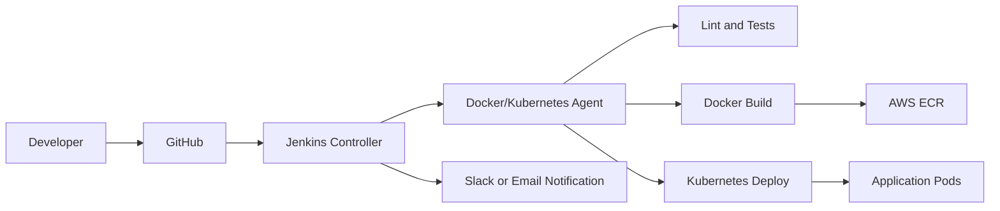

# Jenkins CI/CD Production Pipeline: Build, Test, Lint, Docker Build, Push, Deploy, Rollback, Notifications

## Phase 1: What Are We Building?

We are building a Jenkins CI/CD system that:

1. Checks out code.
2. Installs dependencies.
3. Runs lint.
4. Runs tests.
5. Builds Docker image.
6. Scans image.
7. Pushes image to registry.
8. Deploys to Kubernetes.
9. Supports rollback.
10. Sends notifications.

## Phase 2: Why Does Jenkins Exist?

Jenkins automates software delivery. Without CI/CD, engineers manually run builds, tests, Docker commands, and deployments. Manual deployment causes inconsistency and outages.

## Phase 3: Real World Use Case

A team pushes code to GitHub. Jenkins builds the application, proves tests pass, packages a container, pushes it to ECR, deploys to Kubernetes, and records the deployment.

## Phase 4: Architecture Diagram



## Phase 5: Prerequisites

You need:

1. Docker.
2. GitHub repository.
3. AWS ECR repository or Docker Hub.
4. Kubernetes cluster.
5. kubectl access.

## Phase 6: Run Jenkins With Docker

Create `docker-compose.yml`:

```yaml
services:
  jenkins:
    image: jenkins/jenkins:lts-jdk17
    user: root
    ports:
      - "8080:8080"
      - "50000:50000"
    volumes:
      - jenkins_home:/var/jenkins_home
      - /var/run/docker.sock:/var/run/docker.sock

volumes:
  jenkins_home:
```

Run:

```bash
docker compose up -d
```

Get initial password:

```bash
docker compose exec jenkins cat /var/jenkins_home/secrets/initialAdminPassword
```

Console steps:

1. Open `http://localhost:8080`.
2. Paste the initial admin password.
3. Click `Continue`.
4. Click `Install suggested plugins`.
5. Wait for plugins to install.
6. Create first admin user.
7. Enter username.
8. Enter password.
9. Enter full name.
10. Enter email.
11. Click `Save and Continue`.
12. Confirm Jenkins URL `http://localhost:8080`.
13. Click `Start using Jenkins`.

## Phase 7: Install Required Plugins

Console steps:

1. Click `Manage Jenkins`.
2. Click `Plugins`.
3. Click `Available plugins`.
4. Search and install:
   - Docker Pipeline
   - Kubernetes
   - GitHub Branch Source
   - Pipeline Stage View
   - Credentials Binding
   - Slack Notification if using Slack
5. Check `Restart Jenkins when installation is complete`.

## Phase 8: Configure Credentials

### Docker Registry Credentials

1. Click `Manage Jenkins`.
2. Click `Credentials`.
3. Click `System`.
4. Click `Global credentials`.
5. Click `Add Credentials`.
6. Kind: `Username with password`.
7. Username: Docker Hub username or AWS access key for ECR workflows.
8. Password: token or secret.
9. ID: `docker-registry-credentials`.
10. Click `Create`.

### kubeconfig Secret File

1. Click `Add Credentials`.
2. Kind: `Secret file`.
3. Upload kubeconfig file.
4. ID: `kubeconfig`.
5. Click `Create`.

## Phase 9: Jenkinsfile For FastAPI

Create `Jenkinsfile`:

```groovy
pipeline {
  agent any

  environment {
    IMAGE_NAME = "orders-api"
    IMAGE_TAG = "${env.BUILD_NUMBER}"
    REGISTRY = "your-registry.example.com"
    KUBE_NAMESPACE = "orders"
  }

  options {
    timestamps()
    ansiColor('xterm')
    buildDiscarder(logRotator(numToKeepStr: '20'))
  }

  stages {
    stage('Checkout') {
      steps {
        checkout scm
      }
    }

    stage('Install Dependencies') {
      steps {
        sh 'python -m venv .venv'
        sh '. .venv/bin/activate && pip install -r requirements-dev.txt'
      }
    }

    stage('Lint') {
      steps {
        sh '. .venv/bin/activate && ruff check app tests'
      }
    }

    stage('Test') {
      steps {
        sh '. .venv/bin/activate && pytest -q'
      }
      post {
        always {
          junit allowEmptyResults: true, testResults: 'test-results/*.xml'
        }
      }
    }

    stage('Docker Build') {
      steps {
        sh 'docker build -t $IMAGE_NAME:$IMAGE_TAG .'
      }
    }

    stage('Docker Scan') {
      steps {
        sh 'docker scout cves $IMAGE_NAME:$IMAGE_TAG || true'
      }
    }

    stage('Docker Push') {
      steps {
        withCredentials([usernamePassword(credentialsId: 'docker-registry-credentials', usernameVariable: 'REGISTRY_USER', passwordVariable: 'REGISTRY_PASSWORD')]) {
          sh 'echo "$REGISTRY_PASSWORD" | docker login $REGISTRY -u "$REGISTRY_USER" --password-stdin'
          sh 'docker tag $IMAGE_NAME:$IMAGE_TAG $REGISTRY/$IMAGE_NAME:$IMAGE_TAG'
          sh 'docker push $REGISTRY/$IMAGE_NAME:$IMAGE_TAG'
        }
      }
    }

    stage('Deploy') {
      steps {
        withCredentials([file(credentialsId: 'kubeconfig', variable: 'KUBECONFIG_FILE')]) {
          sh 'export KUBECONFIG=$KUBECONFIG_FILE && kubectl -n $KUBE_NAMESPACE set image deployment/orders-api api=$REGISTRY/$IMAGE_NAME:$IMAGE_TAG'
          sh 'export KUBECONFIG=$KUBECONFIG_FILE && kubectl -n $KUBE_NAMESPACE rollout status deployment/orders-api --timeout=180s'
        }
      }
    }
  }

  post {
    success {
      echo "Deployment succeeded for ${IMAGE_NAME}:${IMAGE_TAG}"
    }
    failure {
      echo "Pipeline failed. Check stage logs."
    }
  }
}
```

## Phase 10: Rollback Pipeline

Create `Jenkinsfile.rollback`:

```groovy
pipeline {
  agent any

  parameters {
    string(name: 'NAMESPACE', defaultValue: 'orders', description: 'Kubernetes namespace')
    string(name: 'DEPLOYMENT', defaultValue: 'orders-api', description: 'Deployment name')
    string(name: 'REVISION', defaultValue: '', description: 'Optional revision number')
  }

  stages {
    stage('Rollback') {
      steps {
        withCredentials([file(credentialsId: 'kubeconfig', variable: 'KUBECONFIG_FILE')]) {
          script {
            if (params.REVISION?.trim()) {
              sh "export KUBECONFIG=$KUBECONFIG_FILE && kubectl -n ${params.NAMESPACE} rollout undo deployment/${params.DEPLOYMENT} --to-revision=${params.REVISION}"
            } else {
              sh "export KUBECONFIG=$KUBECONFIG_FILE && kubectl -n ${params.NAMESPACE} rollout undo deployment/${params.DEPLOYMENT}"
            }
          }
          sh "export KUBECONFIG=$KUBECONFIG_FILE && kubectl -n ${params.NAMESPACE} rollout status deployment/${params.DEPLOYMENT}"
        }
      }
    }
  }
}
```

## Phase 11: Shared Library

Folder:

```text
jenkins-shared-library/
  vars/
    dockerBuildPush.groovy
    kubernetesDeploy.groovy
```

### vars/dockerBuildPush.groovy

```groovy
def call(Map config) {
  sh "docker build -t ${config.image}:${config.tag} ${config.context ?: '.'}"
  withCredentials([usernamePassword(credentialsId: config.credentialsId, usernameVariable: 'REGISTRY_USER', passwordVariable: 'REGISTRY_PASSWORD')]) {
    sh "echo \"\$REGISTRY_PASSWORD\" | docker login ${config.registry} -u \"\$REGISTRY_USER\" --password-stdin"
    sh "docker tag ${config.image}:${config.tag} ${config.registry}/${config.image}:${config.tag}"
    sh "docker push ${config.registry}/${config.image}:${config.tag}"
  }
}
```

### vars/kubernetesDeploy.groovy

```groovy
def call(Map config) {
  withCredentials([file(credentialsId: config.kubeconfigCredentialsId, variable: 'KUBECONFIG_FILE')]) {
    sh "export KUBECONFIG=\$KUBECONFIG_FILE && kubectl -n ${config.namespace} set image deployment/${config.deployment} ${config.container}=${config.image}"
    sh "export KUBECONFIG=\$KUBECONFIG_FILE && kubectl -n ${config.namespace} rollout status deployment/${config.deployment} --timeout=180s"
  }
}
```

## Phase 12: Kubernetes Agent Config

Jenkins Kubernetes plugin pod template:

```yaml
apiVersion: v1
kind: Pod
spec:
  serviceAccountName: jenkins-agent
  containers:
    - name: python
      image: python:3.12-slim
      command:
        - cat
      tty: true
    - name: docker
      image: docker:27-cli
      command:
        - cat
      tty: true
      volumeMounts:
        - name: docker-sock
          mountPath: /var/run/docker.sock
  volumes:
    - name: docker-sock
      hostPath:
        path: /var/run/docker.sock
```

Production warning:
Mounting Docker socket gives high privilege. In production, prefer Kaniko, BuildKit, or cloud-native builders.

## Phase 13: Pipeline Commands

Build manually:

```bash
docker build -t orders-api:local .
```

Run tests:

```bash
python -m venv .venv
. .venv/bin/activate
pip install -r requirements-dev.txt
pytest
```

Deploy manually:

```bash
kubectl -n orders set image deployment/orders-api api=REGISTRY/orders-api:TAG
kubectl -n orders rollout status deployment/orders-api
```

Rollback manually:

```bash
kubectl -n orders rollout undo deployment/orders-api
```

## Monitoring

Jenkins monitoring commands:

```bash
docker compose ps
docker compose logs -f jenkins
docker stats
```

Kubernetes deployment monitoring:

```bash
kubectl -n orders get pods
kubectl -n orders rollout history deployment/orders-api
kubectl -n orders describe deployment orders-api
```

## Debugging

Pipeline cannot find Docker:

1. Confirm Docker is installed on the Jenkins agent.
2. Confirm the Jenkins container has access to Docker socket.
3. Run:

```bash
docker compose exec jenkins docker version
```

Credential failure:

1. Check credential ID matches exactly.
2. Recreate credential.
3. Confirm token has registry permission.

Deployment failure:

```bash
kubectl -n orders describe pod POD_NAME
kubectl -n orders logs POD_NAME
kubectl -n orders rollout status deployment/orders-api
```

## Security

1. Do not run Jenkins permanently as root.
2. Use least privilege credentials.
3. Store secrets in Jenkins credentials, not Jenkinsfile.
4. Rotate tokens.
5. Use branch protection.
6. Require pull requests.
7. Use signed images for high-security environments.
8. Audit who can run deployment jobs.

## Scaling

1. Use Jenkins controller only for orchestration.
2. Use agents for builds.
3. Use Kubernetes dynamic agents.
4. Split large pipelines into parallel stages.
5. Cache dependencies carefully.

## Cost Optimization

1. Use ephemeral agents.
2. Shut down idle build nodes.
3. Keep only recent build logs.
4. Remove old Docker images.
5. Use registry lifecycle policies.

## Enterprise Architecture

Enterprise Jenkins:

1. Controller runs on Kubernetes.
2. Agents are ephemeral.
3. Credentials come from secret manager.
4. Pipelines are defined in Git.
5. Deployments require approval gates.
6. Audit logs are exported.
7. Backups are automated.
8. Disaster recovery is tested.

## Interview Questions

1. What is CI?
2. What is CD?
3. Why should tests run before Docker push?
4. Why use immutable image tags?
5. How does rollback work in Kubernetes?
6. Why are credentials stored outside Jenkinsfile?

## Exercises

1. Create a Jenkins pipeline job.
2. Connect GitHub repository.
3. Run lint and tests.
4. Build a Docker image.
5. Push image to registry.
6. Deploy to Kubernetes.
7. Roll back deployment.

## Solutions

The pipeline works when:

```bash
docker compose up -d
docker compose logs -f jenkins
kubectl -n orders rollout status deployment/orders-api
kubectl -n orders rollout history deployment/orders-api
```

