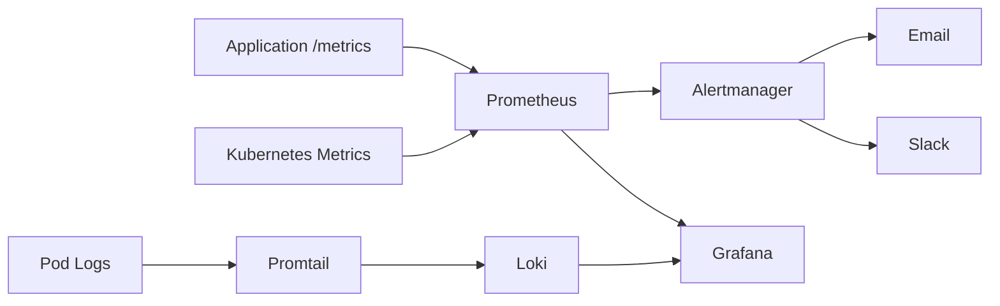

# Observability, Monitoring, Logging, Metrics, Tracing, Dashboards, And Alerts

## Phase 1: What Are We Building?

We are building a production observability stack:

1. Prometheus for metrics.
2. Grafana for dashboards.
3. Loki for logs.
4. Promtail for log shipping.
5. Alertmanager for alerts.
6. Application metrics.
7. Kubernetes monitoring.
8. Production incident debugging commands.

## Phase 2: Why Does It Exist?

Production systems fail. Observability exists so engineers can see symptoms, locate causes, measure impact, and prove recovery.

## Phase 3: Real World Use Case

An API deployment starts returning HTTP 500 errors. You need dashboards, logs, metrics, and alerts to answer:

1. When did it start?
2. Which service failed?
3. Which endpoint failed?
4. Is the database involved?
5. Are users affected?
6. Did the latest deployment cause it?

## Phase 4: Architecture Diagram



## Phase 5: Prerequisites

You need:

1. Kubernetes cluster.
2. Helm.
3. kubectl.
4. A running app with `/metrics`.

## Phase 6: Install kube-prometheus-stack

Add Helm repo:

```bash
helm repo add prometheus-community https://prometheus-community.github.io/helm-charts
helm repo update
```

Purpose:
Adds the Prometheus community chart repository.

Install:

```bash
kubectl create namespace monitoring
helm install monitoring prometheus-community/kube-prometheus-stack \
  --namespace monitoring
```

Expected output:

```text
STATUS: deployed
```

Verify:

```bash
kubectl -n monitoring get pods
```

Expected:

```text
prometheus... Running
grafana... Running
alertmanager... Running
```

Common error:

```text
INSTALLATION FAILED: cannot re-use a name that is still in use
```

Fix:

```bash
helm -n monitoring list
helm -n monitoring upgrade monitoring prometheus-community/kube-prometheus-stack
```

## Phase 7: Open Grafana

Port-forward:

```bash
kubectl -n monitoring port-forward svc/monitoring-grafana 3000:80
```

Get password:

```bash
kubectl -n monitoring get secret monitoring-grafana \
  -o jsonpath="{.data.admin-password}" | base64 -d
```

Console steps:

1. Open `http://localhost:3000`.
2. Username: `admin`.
3. Password: decoded password from command.
4. Click `Log in`.
5. Open `Dashboards`.
6. Open Kubernetes dashboards.

## Phase 8: Add Application ServiceMonitor

Create `orders-api-servicemonitor.yaml`:

```yaml
apiVersion: monitoring.coreos.com/v1
kind: ServiceMonitor
metadata:
  name: orders-api
  namespace: orders
  labels:
    release: monitoring
spec:
  selector:
    matchLabels:
      app: orders-api
  namespaceSelector:
    matchNames:
      - orders
  endpoints:
    - port: http
      path: /metrics
      interval: 15s
```

Make sure the Service has a named port:

```yaml
apiVersion: v1
kind: Service
metadata:
  name: orders-api
  namespace: orders
  labels:
    app: orders-api
spec:
  selector:
    app: orders-api
  ports:
    - name: http
      port: 80
      targetPort: 8000
```

Apply:

```bash
kubectl apply -f orders-api-servicemonitor.yaml
```

Verify target:

1. Open Grafana.
2. Open Prometheus UI by port-forwarding:

```bash
kubectl -n monitoring port-forward svc/monitoring-kube-prometheus-prometheus 9090:9090
```

3. Open `http://localhost:9090/targets`.
4. Find `orders-api`.
5. Confirm target is `UP`.

## Phase 9: Prometheus Alert Rules

Create `orders-api-alerts.yaml`:

```yaml
apiVersion: monitoring.coreos.com/v1
kind: PrometheusRule
metadata:
  name: orders-api-alerts
  namespace: orders
  labels:
    release: monitoring
spec:
  groups:
    - name: orders-api.rules
      rules:
        - alert: OrdersApiHighErrorRate
          expr: |
            sum(rate(orders_api_requests_total{status=~"5.."}[5m]))
            /
            sum(rate(orders_api_requests_total[5m]))
            > 0.05
          for: 5m
          labels:
            severity: critical
          annotations:
            summary: "orders-api high 5xx error rate"
            description: "More than 5% of orders-api requests are failing for 5 minutes."

        - alert: OrdersApiHighLatency
          expr: |
            histogram_quantile(
              0.95,
              sum(rate(orders_api_request_duration_seconds_bucket[5m])) by (le)
            ) > 1
          for: 10m
          labels:
            severity: warning
          annotations:
            summary: "orders-api high p95 latency"
            description: "orders-api p95 latency is above 1 second for 10 minutes."
```

Apply:

```bash
kubectl apply -f orders-api-alerts.yaml
```

## Phase 10: Install Loki And Promtail

Add repo:

```bash
helm repo add grafana https://grafana.github.io/helm-charts
helm repo update
```

Install Loki:

```bash
helm install loki grafana/loki-stack \
  --namespace monitoring \
  --set promtail.enabled=true
```

Verify:

```bash
kubectl -n monitoring get pods | grep loki
kubectl -n monitoring get pods | grep promtail
```

Add Loki data source in Grafana:

1. Open Grafana.
2. Click `Connections`.
3. Click `Data sources`.
4. Click `Add data source`.
5. Choose `Loki`.
6. URL: `http://loki:3100`.
7. Click `Save & test`.

## Phase 11: LogQL Queries

All logs in namespace:

```text
{namespace="orders"}
```

Only orders-api logs:

```text
{namespace="orders", app="orders-api"}
```

Search for errors:

```text
{namespace="orders"} |= "ERROR"
```

JSON log field query:

```text
{namespace="orders"} | json | levelname="ERROR"
```

## Phase 12: Dashboard Panels

Create a Grafana dashboard with panels:

1. Request rate:

```promql
sum(rate(orders_api_requests_total[5m]))
```

2. Error rate:

```promql
sum(rate(orders_api_requests_total{status=~"5.."}[5m]))
/
sum(rate(orders_api_requests_total[5m]))
```

3. p95 latency:

```promql
histogram_quantile(
  0.95,
  sum(rate(orders_api_request_duration_seconds_bucket[5m])) by (le)
)
```

4. Pod CPU:

```promql
sum(rate(container_cpu_usage_seconds_total{namespace="orders"}[5m])) by (pod)
```

5. Pod memory:

```promql
sum(container_memory_working_set_bytes{namespace="orders"}) by (pod)
```

## Phase 13: Alertmanager Email Example

Create `alertmanager-values.yaml`:

```yaml
alertmanager:
  config:
    global:
      smtp_smarthost: 'smtp.example.com:587'
      smtp_from: 'alerts@example.com'
      smtp_auth_username: 'alerts@example.com'
      smtp_auth_password: 'replace-with-secret'
    route:
      receiver: email
      group_by: ['alertname', 'namespace']
      group_wait: 30s
      group_interval: 5m
      repeat_interval: 4h
    receivers:
      - name: email
        email_configs:
          - to: oncall@example.com
            send_resolved: true
```

Upgrade:

```bash
helm upgrade monitoring prometheus-community/kube-prometheus-stack \
  --namespace monitoring \
  -f alertmanager-values.yaml
```

Production warning:
Do not store SMTP passwords in plain Helm values. Use sealed secrets, External Secrets, or cloud secret manager integration.

## Phase 14: Incident Debugging Runbook

When an alert fires:

1. Check alert:

```bash
kubectl -n monitoring port-forward svc/monitoring-kube-prometheus-alertmanager 9093:9093
```

2. Open `http://localhost:9093`.
3. Identify alert name and service.
4. Check pods:

```bash
kubectl -n orders get pods -o wide
```

5. Check rollout:

```bash
kubectl -n orders rollout history deployment/orders-api
```

6. Check logs:

```bash
kubectl -n orders logs deploy/orders-api --tail=100
```

7. Check events:

```bash
kubectl -n orders get events --sort-by=.lastTimestamp
```

8. Check metrics in Grafana.
9. If deployment caused issue, roll back:

```bash
kubectl -n orders rollout undo deployment/orders-api
kubectl -n orders rollout status deployment/orders-api
```

10. Confirm alert resolves.

## Security

1. Protect Grafana with SSO in production.
2. Restrict Prometheus access.
3. Avoid logging secrets.
4. Redact tokens, passwords, and PII.
5. Use retention policies.
6. Use TLS for observability endpoints.

## Scaling

1. Increase Prometheus retention storage.
2. Use remote write for long-term metrics.
3. Use Loki object storage for logs.
4. Shard large Prometheus setups.
5. Use recording rules for expensive queries.

## Cost Optimization

1. Reduce high-cardinality labels.
2. Keep log retention short for dev.
3. Store only useful logs.
4. Sample traces.
5. Avoid debug logging in production unless needed.

## Enterprise Architecture

Enterprise observability includes:

1. Centralized metrics.
2. Centralized logs.
3. Distributed traces.
4. On-call routing.
5. SLOs.
6. Error budgets.
7. Incident review.
8. Runbooks.
9. Synthetic checks.
10. Audit dashboards.

## Interview Questions

1. What is the difference between metrics and logs?
2. What is p95 latency?
3. What makes an alert actionable?
4. Why is high-cardinality dangerous?
5. What is a ServiceMonitor?
6. What does Alertmanager do?

## Exercises

1. Install Prometheus and Grafana.
2. Scrape `orders-api`.
3. Create an error-rate alert.
4. Install Loki.
5. Query logs from namespace `orders`.
6. Create a dashboard with request rate and latency.

## Solutions

Observability works when:

```bash
kubectl -n monitoring get pods
kubectl -n monitoring port-forward svc/monitoring-grafana 3000:80
kubectl -n monitoring port-forward svc/monitoring-kube-prometheus-prometheus 9090:9090
kubectl apply -f orders-api-servicemonitor.yaml
kubectl apply -f orders-api-alerts.yaml
```

