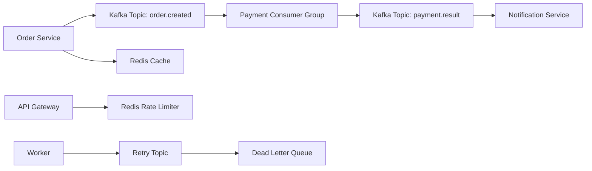

# Kafka And Redis Production Systems: Producer, Consumer, Groups, Retry, DLQ, Event Sourcing, CQRS, Saga, Cache, Rate Limiter, Sessions, Locks, PubSub, Streams

## Phase 1: What Are We Building?

We are building:

1. Kafka producer.
2. Kafka consumer.
3. Consumer group.
4. Retry topic.
5. Dead letter queue.
6. Event sourcing example.
7. CQRS projection.
8. Saga pattern.
9. Redis cache.
10. Redis rate limiter.
11. Redis sessions.
12. Redis distributed lock.
13. Redis PubSub.
14. Redis Streams.
15. Redis leaderboard.

## Phase 2: Why Do Kafka And Redis Exist?

Kafka is for durable event streaming. Redis is for fast in-memory data structures, caching, coordination, and real-time workloads.

## Phase 3: Real World Use Case

When an order is created:

1. Order service writes order to database.
2. Order service publishes `order.created`.
3. Payment service consumes event.
4. Payment service charges card.
5. Payment service publishes `payment.succeeded` or `payment.failed`.
6. Notification service sends email.
7. Redis caches order lookups and limits abusive requests.

## Phase 4: Architecture Diagram



## Phase 5: Prerequisites

You need Docker and Docker Compose.

## Phase 6: Run Kafka And Redis Locally

Create `docker-compose.yml`:

```yaml
services:
  kafka:
    image: bitnami/kafka:3.8
    ports:
      - "9092:9092"
    environment:
      KAFKA_CFG_NODE_ID: 1
      KAFKA_CFG_PROCESS_ROLES: broker,controller
      KAFKA_CFG_CONTROLLER_QUORUM_VOTERS: 1@kafka:9093
      KAFKA_CFG_LISTENERS: PLAINTEXT://:9092,CONTROLLER://:9093
      KAFKA_CFG_ADVERTISED_LISTENERS: PLAINTEXT://localhost:9092
      KAFKA_CFG_CONTROLLER_LISTENER_NAMES: CONTROLLER
      KAFKA_CFG_AUTO_CREATE_TOPICS_ENABLE: "true"

  redis:
    image: redis:7.4-alpine
    ports:
      - "6379:6379"
    command: ["redis-server", "--appendonly", "yes"]
```

Run:

```bash
docker compose up -d
```

Verify Redis:

```bash
docker compose exec redis redis-cli ping
```

Expected:

```text
PONG
```

Verify Kafka:

```bash
docker compose exec kafka kafka-topics.sh --bootstrap-server localhost:9092 --list
```

## Phase 7: Kafka Python Producer And Consumer

### requirements.txt

```text
confluent-kafka==2.6.1
```

### producer.py

```python
import json
import uuid
from datetime import datetime, timezone
from confluent_kafka import Producer

producer = Producer({"bootstrap.servers": "localhost:9092"})


def delivery_report(err, msg):
    if err is not None:
        print(f"delivery failed: {err}")
    else:
        print(f"delivered to {msg.topic()} [{msg.partition()}] offset {msg.offset()}")


event = {
    "event_id": str(uuid.uuid4()),
    "event_type": "order.created",
    "occurred_at": datetime.now(timezone.utc).isoformat(),
    "order_id": 1001,
    "customer_email": "buyer@example.com",
    "total_amount": 49.98,
}

producer.produce(
    "order.created",
    key=str(event["order_id"]),
    value=json.dumps(event),
    callback=delivery_report,
)
producer.flush()
```

### consumer.py

```python
import json
from confluent_kafka import Consumer

consumer = Consumer({
    "bootstrap.servers": "localhost:9092",
    "group.id": "payment-service",
    "auto.offset.reset": "earliest",
    "enable.auto.commit": False,
})

consumer.subscribe(["order.created"])

try:
    while True:
        msg = consumer.poll(1.0)
        if msg is None:
            continue
        if msg.error():
            print(f"consumer error: {msg.error()}")
            continue

        event = json.loads(msg.value().decode("utf-8"))
        print(f"processing event: {event}")
        consumer.commit(msg)
finally:
    consumer.close()
```

Run:

```bash
pip install -r requirements.txt
python consumer.py
python producer.py
```

## Phase 8: Retry And Dead Letter Queue

### retry_consumer.py

```python
import json
import time
from confluent_kafka import Consumer, Producer

consumer = Consumer({
    "bootstrap.servers": "localhost:9092",
    "group.id": "payment-service",
    "auto.offset.reset": "earliest",
    "enable.auto.commit": False,
})
producer = Producer({"bootstrap.servers": "localhost:9092"})

consumer.subscribe(["order.created"])


def process(event: dict) -> None:
    if event["total_amount"] > 1000:
        raise ValueError("payment limit exceeded")
    print(f"payment processed for order {event['order_id']}")


while True:
    msg = consumer.poll(1.0)
    if msg is None:
        continue
    if msg.error():
        print(msg.error())
        continue

    event = json.loads(msg.value().decode("utf-8"))
    attempts = int(event.get("attempts", 0))

    try:
        process(event)
        consumer.commit(msg)
    except Exception as exc:
        event["attempts"] = attempts + 1
        event["last_error"] = str(exc)
        target_topic = "order.retry" if event["attempts"] <= 3 else "order.dlq"
        producer.produce(target_topic, key=str(event["order_id"]), value=json.dumps(event))
        producer.flush()
        consumer.commit(msg)
        time.sleep(1)
```

Create topics:

```bash
docker compose exec kafka kafka-topics.sh --bootstrap-server localhost:9092 --create --topic order.created --partitions 3 --replication-factor 1
docker compose exec kafka kafka-topics.sh --bootstrap-server localhost:9092 --create --topic order.retry --partitions 3 --replication-factor 1
docker compose exec kafka kafka-topics.sh --bootstrap-server localhost:9092 --create --topic order.dlq --partitions 3 --replication-factor 1
```

## Phase 9: Node.js Kafka Producer

### package.json

```json
{
  "name": "kafka-node-producer",
  "version": "1.0.0",
  "type": "module",
  "dependencies": {
    "kafkajs": "2.2.4"
  },
  "scripts": {
    "start": "node producer.js"
  }
}
```

### producer.js

```javascript
import { Kafka } from "kafkajs";

const kafka = new Kafka({
  clientId: "orders-node",
  brokers: ["localhost:9092"]
});

const producer = kafka.producer();
await producer.connect();

await producer.send({
  topic: "order.created",
  messages: [
    {
      key: "2001",
      value: JSON.stringify({
        eventId: crypto.randomUUID(),
        eventType: "order.created",
        orderId: 2001,
        totalAmount: 79.99
      })
    }
  ]
});

await producer.disconnect();
```

## Phase 10: Redis Cache

### redis_cache.py

```python
import json
import redis

client = redis.Redis(host="localhost", port=6379, decode_responses=True)


def get_order(order_id: int) -> dict:
    key = f"order:{order_id}"
    cached = client.get(key)
    if cached:
        return json.loads(cached)

    order = {
        "id": order_id,
        "product_code": "BOOK-001",
        "total_amount": 49.98,
    }
    client.setex(key, 300, json.dumps(order))
    return order


print(get_order(1))
print(get_order(1))
```

Purpose:
Caches order data for 300 seconds.

## Phase 11: Redis Rate Limiter

### rate_limiter.py

```python
import time
import redis

client = redis.Redis(host="localhost", port=6379, decode_responses=True)


def allow_request(user_id: str, limit: int = 5, window_seconds: int = 60) -> bool:
    key = f"rate:{user_id}:{int(time.time() // window_seconds)}"
    count = client.incr(key)
    if count == 1:
        client.expire(key, window_seconds)
    return count <= limit


for _ in range(7):
    print(allow_request("user-123"))
```

Expected output:

```text
True
True
True
True
True
False
False
```

## Phase 12: Redis Sessions

### sessions.py

```python
import json
import secrets
import redis

client = redis.Redis(host="localhost", port=6379, decode_responses=True)


def create_session(user_id: str) -> str:
    token = secrets.token_urlsafe(32)
    client.setex(f"session:{token}", 3600, json.dumps({"user_id": user_id}))
    return token


def get_session(token: str) -> dict | None:
    value = client.get(f"session:{token}")
    return json.loads(value) if value else None


token = create_session("user-123")
print(token)
print(get_session(token))
```

## Phase 13: Redis Distributed Lock

### lock.py

```python
import time
import uuid
import redis

client = redis.Redis(host="localhost", port=6379, decode_responses=True)


def acquire_lock(name: str, ttl_seconds: int = 10) -> str | None:
    token = str(uuid.uuid4())
    ok = client.set(f"lock:{name}", token, nx=True, ex=ttl_seconds)
    return token if ok else None


def release_lock(name: str, token: str) -> bool:
    script = """
    if redis.call("get", KEYS[1]) == ARGV[1] then
      return redis.call("del", KEYS[1])
    else
      return 0
    end
    """
    return client.eval(script, 1, f"lock:{name}", token) == 1


token = acquire_lock("order-1001")
if token:
    print("lock acquired")
    time.sleep(1)
    print(release_lock("order-1001", token))
else:
    print("lock busy")
```

## Phase 14: Redis PubSub

### subscriber.py

```python
import redis

client = redis.Redis(host="localhost", port=6379, decode_responses=True)
pubsub = client.pubsub()
pubsub.subscribe("notifications")

for message in pubsub.listen():
    if message["type"] == "message":
        print(f"received: {message['data']}")
```

### publisher.py

```python
import redis

client = redis.Redis(host="localhost", port=6379, decode_responses=True)
client.publish("notifications", "order shipped")
```

## Phase 15: Redis Streams

### stream_producer.py

```python
import redis

client = redis.Redis(host="localhost", port=6379, decode_responses=True)
message_id = client.xadd("order-events", {"type": "order.created", "order_id": "1001"})
print(message_id)
```

### stream_consumer.py

```python
import redis

client = redis.Redis(host="localhost", port=6379, decode_responses=True)

try:
    client.xgroup_create("order-events", "notification-service", id="0", mkstream=True)
except redis.ResponseError:
    pass

while True:
    messages = client.xreadgroup("notification-service", "consumer-1", {"order-events": ">"}, count=10, block=5000)
    for stream, entries in messages:
        for message_id, fields in entries:
            print(message_id, fields)
            client.xack("order-events", "notification-service", message_id)
```

## Phase 16: Redis Leaderboard

### leaderboard.py

```python
import redis

client = redis.Redis(host="localhost", port=6379, decode_responses=True)

client.zadd("leaderboard", {"alice": 100, "bob": 250, "charlie": 175})

top = client.zrevrange("leaderboard", 0, 2, withscores=True)
print(top)
```

## Production Implementation

Kafka production:

1. Use multiple brokers.
2. Use replication factor 3.
3. Use partitions based on throughput and ordering requirements.
4. Use schema registry.
5. Use idempotent producers.
6. Monitor consumer lag.
7. Use DLQs.
8. Secure with TLS and SASL/IAM.

Redis production:

1. Use managed Redis.
2. Keep Redis private.
3. Enable authentication.
4. Use TTLs.
5. Avoid unbounded keys.
6. Monitor memory.
7. Use eviction policy intentionally.

## Monitoring

Kafka:

```bash
docker compose exec kafka kafka-consumer-groups.sh \
  --bootstrap-server localhost:9092 \
  --describe \
  --group payment-service
```

Redis:

```bash
docker compose exec redis redis-cli INFO
docker compose exec redis redis-cli MEMORY STATS
docker compose exec redis redis-cli KEYS '*'
```

Production warning:
Do not run `KEYS *` on large production Redis. Use `SCAN`.

## Debugging

Kafka consumer not receiving:

1. Check topic exists.
2. Check bootstrap server.
3. Check consumer group.
4. Check offset reset.
5. Check producer delivery report.

Redis cache misses:

1. Check key names.
2. Check TTL.
3. Check serialization.
4. Check Redis connection.

## Security

1. Do not expose Kafka publicly.
2. Do not expose Redis publicly.
3. Use TLS.
4. Use authentication.
5. Restrict network access.
6. Avoid logging event payloads with secrets.

## Scaling

Kafka:

1. Add partitions for parallelism.
2. Add consumers in same group.
3. Add brokers for storage and throughput.

Redis:

1. Use clustering.
2. Use read replicas.
3. Split hot keys.
4. Set TTLs.

## Cost Optimization

1. Retain Kafka messages only as long as needed.
2. Compress Kafka messages.
3. Avoid excessive partitions.
4. Use Redis memory carefully.
5. Delete unused keys.

## Enterprise Architecture

Enterprise event platform:

1. Managed Kafka or MSK.
2. Schema registry.
3. Topic naming standards.
4. Access control per service.
5. DLQ processing.
6. Replay strategy.
7. Event contracts.
8. Consumer lag alerts.

## Interview Questions

1. What is a Kafka topic?
2. What is a partition?
3. What is a consumer group?
4. Why use a DLQ?
5. What is Redis TTL?
6. Why is Redis fast?
7. What is a distributed lock risk?
8. What is CQRS?

## Exercises

1. Create `order.created` topic.
2. Produce an event.
3. Consume with group `payment-service`.
4. Send failures to DLQ.
5. Build Redis cache.
6. Build Redis rate limiter.
7. Build Redis stream consumer group.

## Solutions

Kafka and Redis work when:

```bash
docker compose up -d
docker compose exec redis redis-cli ping
docker compose exec kafka kafka-topics.sh --bootstrap-server localhost:9092 --list
python producer.py
python consumer.py
python rate_limiter.py
```

