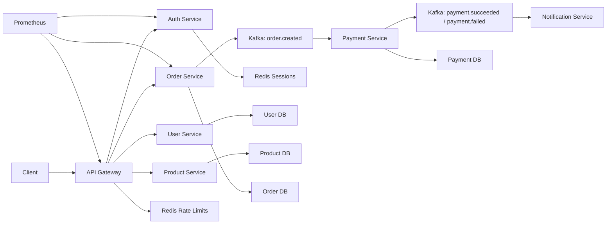

# Production Microservices Platform: Auth, User, Product, Order, Payment, Notification, API Gateway, Kafka, Redis, Observability, CI/CD

## Phase 1: What Are We Building?

We are building a production-style microservices platform:

1. API Gateway.
2. Auth Service.
3. User Service.
4. Product Service.
5. Order Service.
6. Payment Service.
7. Notification Service.
8. PostgreSQL databases.
9. Redis.
10. Kafka.
11. Docker Compose.
12. Kubernetes.
13. CI/CD.
14. Observability.

## Phase 2: Why Does It Exist?

Microservices separate business capabilities so teams can develop, deploy, scale, and operate services independently.

## Phase 3: Real World Use Case

An online store needs:

1. Authentication.
2. User profiles.
3. Product catalog.
4. Order creation.
5. Payment processing.
6. Email notifications.
7. Event-driven communication.
8. Reliable deployment and monitoring.

## Phase 4: Architecture Diagram



## Phase 5: Prerequisites

You need:

1. Docker.
2. Docker Compose.
3. Python 3.12.
4. Node.js for optional frontend.
5. Kubernetes for production deployment.

## Phase 6: Folder Structure

```text
microservices-platform/
  docker-compose.yml
  gateway/
    app.py
    requirements.txt
    Dockerfile
  auth-service/
    app.py
    requirements.txt
    Dockerfile
  user-service/
    app.py
    requirements.txt
    Dockerfile
  product-service/
    app.py
    requirements.txt
    Dockerfile
  order-service/
    app.py
    requirements.txt
    Dockerfile
  payment-service/
    worker.py
    requirements.txt
    Dockerfile
  notification-service/
    worker.py
    requirements.txt
    Dockerfile
  k8s/
    namespace.yaml
    services.yaml
    deployments.yaml
  Jenkinsfile
```

## Phase 7: Shared Python Requirements

Use this in each FastAPI service:

```text
fastapi==0.115.6
uvicorn[standard]==0.32.1
httpx==0.28.1
redis==5.2.1
confluent-kafka==2.6.1
prometheus-client==0.21.1
```

Worker services use:

```text
confluent-kafka==2.6.1
redis==5.2.1
```

## Phase 8: API Gateway

### gateway/app.py

```python
import os
import httpx
import redis
from fastapi import FastAPI, HTTPException, Request

app = FastAPI(title="api-gateway")
cache = redis.Redis(host=os.getenv("REDIS_HOST", "redis"), port=6379, decode_responses=True)

SERVICES = {
    "auth": os.getenv("AUTH_URL", "http://auth-service:8000"),
    "users": os.getenv("USER_URL", "http://user-service:8000"),
    "products": os.getenv("PRODUCT_URL", "http://product-service:8000"),
    "orders": os.getenv("ORDER_URL", "http://order-service:8000"),
}


def rate_limit(client_ip: str) -> bool:
    key = f"rate:{client_ip}"
    count = cache.incr(key)
    if count == 1:
        cache.expire(key, 60)
    return count <= 100


@app.get("/health")
def health():
    return {"status": "ok", "service": "api-gateway"}


@app.api_route("/{service}/{path:path}", methods=["GET", "POST", "PUT", "PATCH", "DELETE"])
async def proxy(service: str, path: str, request: Request):
    if service not in SERVICES:
        raise HTTPException(status_code=404, detail="Unknown service")

    client_ip = request.client.host if request.client else "unknown"
    if not rate_limit(client_ip):
        raise HTTPException(status_code=429, detail="Rate limit exceeded")

    body = await request.body()
    async with httpx.AsyncClient(timeout=10) as client:
        response = await client.request(
            request.method,
            f"{SERVICES[service]}/{path}",
            content=body,
            headers={k: v for k, v in request.headers.items() if k.lower() != "host"},
        )
    return response.json()
```

### gateway/Dockerfile

```dockerfile
FROM python:3.12-slim
WORKDIR /app
COPY requirements.txt .
RUN pip install --no-cache-dir -r requirements.txt
COPY app.py .
RUN adduser --disabled-password --gecos "" appuser
USER appuser
EXPOSE 8000
CMD ["uvicorn", "app:app", "--host", "0.0.0.0", "--port", "8000"]
```

## Phase 9: Auth Service

### auth-service/app.py

```python
import os
import secrets
import redis
from fastapi import FastAPI, HTTPException
from pydantic import BaseModel, EmailStr

app = FastAPI(title="auth-service")
cache = redis.Redis(host=os.getenv("REDIS_HOST", "redis"), port=6379, decode_responses=True)


class LoginRequest(BaseModel):
    email: EmailStr
    password: str


@app.get("/health")
def health():
    return {"status": "ok", "service": "auth-service"}


@app.post("/login")
def login(payload: LoginRequest):
    if payload.password != "dev-password":
        raise HTTPException(status_code=401, detail="Invalid credentials")
    token = secrets.token_urlsafe(32)
    cache.setex(f"session:{token}", 3600, payload.email)
    return {"access_token": token, "token_type": "bearer"}


@app.get("/sessions/{token}")
def session(token: str):
    email = cache.get(f"session:{token}")
    if not email:
        raise HTTPException(status_code=404, detail="Session not found")
    return {"email": email}
```

Production note:
Replace the demo password with hashed passwords or external identity provider integration such as Cognito, Auth0, Clerk, or enterprise SSO.

## Phase 10: User Service

### user-service/app.py

```python
from fastapi import FastAPI
from pydantic import BaseModel, EmailStr

app = FastAPI(title="user-service")
USERS: dict[str, dict] = {}


class UserCreate(BaseModel):
    email: EmailStr
    full_name: str


@app.get("/health")
def health():
    return {"status": "ok", "service": "user-service"}


@app.post("/users")
def create_user(payload: UserCreate):
    USERS[payload.email] = payload.model_dump()
    return USERS[payload.email]


@app.get("/users/{email}")
def get_user(email: str):
    return USERS.get(email, {"error": "not found"})
```

Production note:
Replace in-memory storage with PostgreSQL.

## Phase 11: Product Service

### product-service/app.py

```python
from fastapi import FastAPI, HTTPException
from pydantic import BaseModel

app = FastAPI(title="product-service")

PRODUCTS = {
    "BOOK-001": {"code": "BOOK-001", "name": "Production Engineering Handbook", "price": 49.99},
    "COURSE-001": {"code": "COURSE-001", "name": "Kubernetes Deep Dive", "price": 199.99},
}


class ProductCreate(BaseModel):
    code: str
    name: str
    price: float


@app.get("/health")
def health():
    return {"status": "ok", "service": "product-service"}


@app.get("/products")
def list_products():
    return list(PRODUCTS.values())


@app.get("/products/{code}")
def get_product(code: str):
    if code not in PRODUCTS:
        raise HTTPException(status_code=404, detail="Product not found")
    return PRODUCTS[code]


@app.post("/products")
def create_product(payload: ProductCreate):
    PRODUCTS[payload.code] = payload.model_dump()
    return PRODUCTS[payload.code]
```

## Phase 12: Order Service With Kafka Producer

### order-service/app.py

```python
import json
import os
import uuid
from datetime import datetime, timezone
from confluent_kafka import Producer
from fastapi import FastAPI
from pydantic import BaseModel, EmailStr

app = FastAPI(title="order-service")
producer = Producer({"bootstrap.servers": os.getenv("KAFKA_BOOTSTRAP_SERVERS", "kafka:9092")})
ORDERS: dict[str, dict] = {}


class OrderCreate(BaseModel):
    customer_email: EmailStr
    product_code: str
    quantity: int
    total_amount: float


@app.get("/health")
def health():
    return {"status": "ok", "service": "order-service"}


@app.post("/orders")
def create_order(payload: OrderCreate):
    order_id = str(uuid.uuid4())
    order = {
        "order_id": order_id,
        **payload.model_dump(),
        "status": "created",
        "created_at": datetime.now(timezone.utc).isoformat(),
    }
    ORDERS[order_id] = order

    event = {
        "event_id": str(uuid.uuid4()),
        "event_type": "order.created",
        "occurred_at": datetime.now(timezone.utc).isoformat(),
        "data": order,
    }
    producer.produce("order.created", key=order_id, value=json.dumps(event))
    producer.flush()
    return order


@app.get("/orders/{order_id}")
def get_order(order_id: str):
    return ORDERS.get(order_id, {"error": "not found"})
```

## Phase 13: Payment Service Consumer

### payment-service/worker.py

```python
import json
import os
import uuid
from datetime import datetime, timezone
from confluent_kafka import Consumer, Producer

bootstrap = os.getenv("KAFKA_BOOTSTRAP_SERVERS", "kafka:9092")
consumer = Consumer({
    "bootstrap.servers": bootstrap,
    "group.id": "payment-service",
    "auto.offset.reset": "earliest",
    "enable.auto.commit": False,
})
producer = Producer({"bootstrap.servers": bootstrap})
consumer.subscribe(["order.created"])


def charge_payment(order: dict) -> dict:
    status = "payment.succeeded" if order["total_amount"] < 500 else "payment.failed"
    return {
        "event_id": str(uuid.uuid4()),
        "event_type": status,
        "occurred_at": datetime.now(timezone.utc).isoformat(),
        "data": {
            "order_id": order["order_id"],
            "amount": order["total_amount"],
            "status": status,
        },
    }


while True:
    msg = consumer.poll(1.0)
    if msg is None:
        continue
    if msg.error():
        print(msg.error(), flush=True)
        continue

    event = json.loads(msg.value().decode("utf-8"))
    result = charge_payment(event["data"])
    producer.produce("payment.result", key=event["data"]["order_id"], value=json.dumps(result))
    producer.flush()
    consumer.commit(msg)
    print(f"processed payment event {result}", flush=True)
```

## Phase 14: Notification Service Consumer

### notification-service/worker.py

```python
import json
import os
from confluent_kafka import Consumer

consumer = Consumer({
    "bootstrap.servers": os.getenv("KAFKA_BOOTSTRAP_SERVERS", "kafka:9092"),
    "group.id": "notification-service",
    "auto.offset.reset": "earliest",
    "enable.auto.commit": False,
})
consumer.subscribe(["payment.result"])

while True:
    msg = consumer.poll(1.0)
    if msg is None:
        continue
    if msg.error():
        print(msg.error(), flush=True)
        continue

    event = json.loads(msg.value().decode("utf-8"))
    print(f"sending notification for {event}", flush=True)
    consumer.commit(msg)
```

## Phase 15: Service Dockerfile

Use this Dockerfile for each FastAPI service:

```dockerfile
FROM python:3.12-slim

WORKDIR /app

COPY requirements.txt .
RUN pip install --no-cache-dir -r requirements.txt

COPY app.py .

RUN adduser --disabled-password --gecos "" appuser
USER appuser

EXPOSE 8000
CMD ["uvicorn", "app:app", "--host", "0.0.0.0", "--port", "8000"]
```

Worker Dockerfile:

```dockerfile
FROM python:3.12-slim

WORKDIR /app

COPY requirements.txt .
RUN pip install --no-cache-dir -r requirements.txt

COPY worker.py .

RUN adduser --disabled-password --gecos "" worker
USER worker

CMD ["python", "worker.py"]
```

## Phase 16: Docker Compose Platform

### docker-compose.yml

```yaml
services:
  gateway:
    build: ./gateway
    ports:
      - "8080:8000"
    environment:
      REDIS_HOST: redis
      AUTH_URL: http://auth-service:8000
      USER_URL: http://user-service:8000
      PRODUCT_URL: http://product-service:8000
      ORDER_URL: http://order-service:8000
    depends_on:
      - redis
      - auth-service
      - user-service
      - product-service
      - order-service

  auth-service:
    build: ./auth-service
    environment:
      REDIS_HOST: redis
    depends_on:
      - redis

  user-service:
    build: ./user-service

  product-service:
    build: ./product-service

  order-service:
    build: ./order-service
    environment:
      KAFKA_BOOTSTRAP_SERVERS: kafka:9092
    depends_on:
      - kafka

  payment-service:
    build: ./payment-service
    environment:
      KAFKA_BOOTSTRAP_SERVERS: kafka:9092
    depends_on:
      - kafka

  notification-service:
    build: ./notification-service
    environment:
      KAFKA_BOOTSTRAP_SERVERS: kafka:9092
    depends_on:
      - kafka

  redis:
    image: redis:7.4-alpine
    command: ["redis-server", "--appendonly", "yes"]

  kafka:
    image: bitnami/kafka:3.8
    environment:
      KAFKA_CFG_NODE_ID: 1
      KAFKA_CFG_PROCESS_ROLES: broker,controller
      KAFKA_CFG_CONTROLLER_QUORUM_VOTERS: 1@kafka:9093
      KAFKA_CFG_LISTENERS: PLAINTEXT://:9092,CONTROLLER://:9093
      KAFKA_CFG_ADVERTISED_LISTENERS: PLAINTEXT://kafka:9092
      KAFKA_CFG_CONTROLLER_LISTENER_NAMES: CONTROLLER
      KAFKA_CFG_AUTO_CREATE_TOPICS_ENABLE: "true"
```

Run:

```bash
docker compose up --build
```

Test:

```bash
curl http://localhost:8080/product/products
curl -X POST http://localhost:8080/order/orders \
  -H "Content-Type: application/json" \
  -d '{"customer_email":"buyer@example.com","product_code":"BOOK-001","quantity":1,"total_amount":49.99}'
docker compose logs -f payment-service
docker compose logs -f notification-service
```

## Phase 17: Kubernetes Namespace

### k8s/namespace.yaml

```yaml
apiVersion: v1
kind: Namespace
metadata:
  name: platform
```

## Phase 18: Kubernetes Services

### k8s/services.yaml

```yaml
apiVersion: v1
kind: Service
metadata:
  name: gateway
  namespace: platform
spec:
  selector:
    app: gateway
  ports:
    - name: http
      port: 80
      targetPort: 8000
---
apiVersion: v1
kind: Service
metadata:
  name: auth-service
  namespace: platform
spec:
  selector:
    app: auth-service
  ports:
    - name: http
      port: 8000
      targetPort: 8000
---
apiVersion: v1
kind: Service
metadata:
  name: user-service
  namespace: platform
spec:
  selector:
    app: user-service
  ports:
    - name: http
      port: 8000
      targetPort: 8000
---
apiVersion: v1
kind: Service
metadata:
  name: product-service
  namespace: platform
spec:
  selector:
    app: product-service
  ports:
    - name: http
      port: 8000
      targetPort: 8000
---
apiVersion: v1
kind: Service
metadata:
  name: order-service
  namespace: platform
spec:
  selector:
    app: order-service
  ports:
    - name: http
      port: 8000
      targetPort: 8000
---
apiVersion: v1
kind: Service
metadata:
  name: redis
  namespace: platform
spec:
  selector:
    app: redis
  ports:
    - name: redis
      port: 6379
      targetPort: 6379
---
apiVersion: v1
kind: Service
metadata:
  name: kafka
  namespace: platform
spec:
  selector:
    app: kafka
  ports:
    - name: kafka
      port: 9092
      targetPort: 9092
```

## Phase 19: Kubernetes Deployments

### k8s/deployments.yaml

```yaml
apiVersion: apps/v1
kind: Deployment
metadata:
  name: gateway
  namespace: platform
spec:
  replicas: 2
  selector:
    matchLabels:
      app: gateway
  template:
    metadata:
      labels:
        app: gateway
    spec:
      containers:
        - name: gateway
          image: your-registry/gateway:1.0
          ports:
            - containerPort: 8000
          env:
            - name: REDIS_HOST
              value: redis
            - name: AUTH_URL
              value: http://auth-service:8000
            - name: USER_URL
              value: http://user-service:8000
            - name: PRODUCT_URL
              value: http://product-service:8000
            - name: ORDER_URL
              value: http://order-service:8000
          readinessProbe:
            httpGet:
              path: /health
              port: 8000
          livenessProbe:
            httpGet:
              path: /health
              port: 8000
          resources:
            requests:
              cpu: 100m
              memory: 128Mi
            limits:
              cpu: 500m
              memory: 512Mi
---
apiVersion: apps/v1
kind: Deployment
metadata:
  name: auth-service
  namespace: platform
spec:
  replicas: 2
  selector:
    matchLabels:
      app: auth-service
  template:
    metadata:
      labels:
        app: auth-service
    spec:
      containers:
        - name: auth-service
          image: your-registry/auth-service:1.0
          ports:
            - containerPort: 8000
          env:
            - name: REDIS_HOST
              value: redis
          readinessProbe:
            httpGet:
              path: /health
              port: 8000
          livenessProbe:
            httpGet:
              path: /health
              port: 8000
          resources:
            requests:
              cpu: 100m
              memory: 128Mi
            limits:
              cpu: 500m
              memory: 512Mi
---
apiVersion: apps/v1
kind: Deployment
metadata:
  name: user-service
  namespace: platform
spec:
  replicas: 2
  selector:
    matchLabels:
      app: user-service
  template:
    metadata:
      labels:
        app: user-service
    spec:
      containers:
        - name: user-service
          image: your-registry/user-service:1.0
          ports:
            - containerPort: 8000
          readinessProbe:
            httpGet:
              path: /health
              port: 8000
          livenessProbe:
            httpGet:
              path: /health
              port: 8000
          resources:
            requests:
              cpu: 100m
              memory: 128Mi
            limits:
              cpu: 500m
              memory: 512Mi
---
apiVersion: apps/v1
kind: Deployment
metadata:
  name: product-service
  namespace: platform
spec:
  replicas: 2
  selector:
    matchLabels:
      app: product-service
  template:
    metadata:
      labels:
        app: product-service
    spec:
      containers:
        - name: product-service
          image: your-registry/product-service:1.0
          ports:
            - containerPort: 8000
          readinessProbe:
            httpGet:
              path: /health
              port: 8000
          livenessProbe:
            httpGet:
              path: /health
              port: 8000
          resources:
            requests:
              cpu: 100m
              memory: 128Mi
            limits:
              cpu: 500m
              memory: 512Mi
---
apiVersion: apps/v1
kind: Deployment
metadata:
  name: order-service
  namespace: platform
spec:
  replicas: 2
  selector:
    matchLabels:
      app: order-service
  template:
    metadata:
      labels:
        app: order-service
    spec:
      containers:
        - name: order-service
          image: your-registry/order-service:1.0
          ports:
            - containerPort: 8000
          env:
            - name: KAFKA_BOOTSTRAP_SERVERS
              value: kafka:9092
          readinessProbe:
            httpGet:
              path: /health
              port: 8000
          livenessProbe:
            httpGet:
              path: /health
              port: 8000
          resources:
            requests:
              cpu: 100m
              memory: 128Mi
            limits:
              cpu: 500m
              memory: 512Mi
---
apiVersion: apps/v1
kind: Deployment
metadata:
  name: payment-service
  namespace: platform
spec:
  replicas: 2
  selector:
    matchLabels:
      app: payment-service
  template:
    metadata:
      labels:
        app: payment-service
    spec:
      containers:
        - name: payment-service
          image: your-registry/payment-service:1.0
          env:
            - name: KAFKA_BOOTSTRAP_SERVERS
              value: kafka:9092
          resources:
            requests:
              cpu: 100m
              memory: 128Mi
            limits:
              cpu: 500m
              memory: 512Mi
---
apiVersion: apps/v1
kind: Deployment
metadata:
  name: notification-service
  namespace: platform
spec:
  replicas: 2
  selector:
    matchLabels:
      app: notification-service
  template:
    metadata:
      labels:
        app: notification-service
    spec:
      containers:
        - name: notification-service
          image: your-registry/notification-service:1.0
          env:
            - name: KAFKA_BOOTSTRAP_SERVERS
              value: kafka:9092
          resources:
            requests:
              cpu: 100m
              memory: 128Mi
            limits:
              cpu: 500m
              memory: 512Mi
---
apiVersion: apps/v1
kind: Deployment
metadata:
  name: redis
  namespace: platform
spec:
  replicas: 1
  selector:
    matchLabels:
      app: redis
  template:
    metadata:
      labels:
        app: redis
    spec:
      containers:
        - name: redis
          image: redis:7.4-alpine
          ports:
            - containerPort: 6379
          command: ["redis-server", "--appendonly", "yes"]
          resources:
            requests:
              cpu: 100m
              memory: 128Mi
            limits:
              cpu: 500m
              memory: 512Mi
---
apiVersion: apps/v1
kind: Deployment
metadata:
  name: kafka
  namespace: platform
spec:
  replicas: 1
  selector:
    matchLabels:
      app: kafka
  template:
    metadata:
      labels:
        app: kafka
    spec:
      containers:
        - name: kafka
          image: bitnami/kafka:3.8
          ports:
            - containerPort: 9092
          env:
            - name: KAFKA_CFG_NODE_ID
              value: "1"
            - name: KAFKA_CFG_PROCESS_ROLES
              value: broker,controller
            - name: KAFKA_CFG_CONTROLLER_QUORUM_VOTERS
              value: 1@kafka:9093
            - name: KAFKA_CFG_LISTENERS
              value: PLAINTEXT://:9092,CONTROLLER://:9093
            - name: KAFKA_CFG_ADVERTISED_LISTENERS
              value: PLAINTEXT://kafka:9092
            - name: KAFKA_CFG_CONTROLLER_LISTENER_NAMES
              value: CONTROLLER
            - name: KAFKA_CFG_AUTO_CREATE_TOPICS_ENABLE
              value: "true"
          resources:
            requests:
              cpu: 250m
              memory: 512Mi
            limits:
              cpu: "1"
              memory: 1Gi
```

## Phase 20: Jenkinsfile

```groovy
pipeline {
  agent any

  environment {
    REGISTRY = "your-registry.example.com"
    NAMESPACE = "platform"
  }

  stages {
    stage('Test Services') {
      steps {
        sh 'for d in gateway auth-service user-service product-service order-service; do cd $d && pip install -r requirements.txt && cd ..; done'
      }
    }

    stage('Build Images') {
      steps {
        sh 'for d in gateway auth-service user-service product-service order-service payment-service notification-service; do docker build -t $REGISTRY/$d:$BUILD_NUMBER $d; done'
      }
    }

    stage('Push Images') {
      steps {
        withCredentials([usernamePassword(credentialsId: 'docker-registry-credentials', usernameVariable: 'REGISTRY_USER', passwordVariable: 'REGISTRY_PASSWORD')]) {
          sh 'echo "$REGISTRY_PASSWORD" | docker login $REGISTRY -u "$REGISTRY_USER" --password-stdin'
          sh 'for d in gateway auth-service user-service product-service order-service payment-service notification-service; do docker push $REGISTRY/$d:$BUILD_NUMBER; done'
        }
      }
    }

    stage('Deploy') {
      steps {
        withCredentials([file(credentialsId: 'kubeconfig', variable: 'KUBECONFIG_FILE')]) {
          sh 'export KUBECONFIG=$KUBECONFIG_FILE && kubectl apply -f k8s/'
          sh 'export KUBECONFIG=$KUBECONFIG_FILE && kubectl -n $NAMESPACE rollout status deployment/order-service'
        }
      }
    }
  }
}
```

## Production Implementation

Replace learning shortcuts:

1. Replace in-memory service storage with PostgreSQL.
2. Replace local Kafka with MSK or managed Kafka.
3. Replace local Redis with ElastiCache.
4. Replace demo auth with Cognito, Auth0, Clerk, or custom hashed password auth.
5. Use separate databases per service.
6. Add API versioning.
7. Add request IDs.
8. Add OpenTelemetry traces.
9. Add schema registry for Kafka.
10. Add DLQ processors.

## Monitoring

Commands:

```bash
docker compose ps
docker compose logs -f order-service
docker compose logs -f payment-service
docker compose logs -f notification-service
kubectl -n platform get pods
kubectl -n platform logs deploy/order-service
```

Metrics to track:

1. Request rate.
2. Error rate.
3. Latency.
4. Kafka consumer lag.
5. Redis memory.
6. Database connections.
7. Payment failures.
8. Notification failures.

## Debugging

Gateway cannot reach service:

```bash
docker compose exec gateway python -c "import httpx; print(httpx.get('http://order-service:8000/health').json())"
```

Kafka not processing:

```bash
docker compose logs kafka
docker compose logs payment-service
```

Kubernetes service discovery:

```bash
kubectl -n platform exec deploy/gateway -- nslookup order-service
```

## Security

1. Validate JWTs at gateway.
2. Apply rate limits.
3. Use mTLS for service-to-service in advanced environments.
4. Keep databases private.
5. Use separate DB users per service.
6. Use least privilege Kafka ACLs.
7. Scan images.
8. Use NetworkPolicies.

## Scaling

1. Scale gateway horizontally.
2. Scale stateless APIs with HPA.
3. Scale Kafka consumers by partition count.
4. Cache product reads.
5. Use database read replicas for read-heavy services.
6. Use async events for slow workflows.

Scale command:

```bash
kubectl -n platform scale deployment order-service --replicas=5
```

## Cost Optimization

1. Use managed services only where operational value is worth cost.
2. Keep dev replicas low.
3. Set log retention.
4. Use autoscaling.
5. Avoid over-partitioning Kafka.
6. Use cache TTLs.

## Enterprise Architecture

Enterprise microservices platform includes:

1. API gateway.
2. Identity provider.
3. Service mesh.
4. Platform observability.
5. Centralized logging.
6. GitOps.
7. Secrets manager.
8. Policy as code.
9. Incident response.
10. Disaster recovery.

## Interview Questions

1. Why split services by business capability?
2. What is the API Gateway pattern?
3. What is eventual consistency?
4. Why use Kafka between services?
5. What is a saga?
6. How do you debug microservice latency?
7. How do you prevent cascading failures?

## Exercises

1. Run the platform with Docker Compose.
2. Create an order through gateway.
3. Watch payment-service consume the event.
4. Watch notification-service consume payment result.
5. Add DLQ handling to payment-service.
6. Add Redis product cache.
7. Deploy services to Kubernetes.
8. Add Prometheus ServiceMonitors.

## Solutions

The platform works when:

```bash
docker compose up --build
curl http://localhost:8080/product/products
curl -X POST http://localhost:8080/order/orders -H "Content-Type: application/json" -d '{"customer_email":"buyer@example.com","product_code":"BOOK-001","quantity":1,"total_amount":49.99}'
docker compose logs -f payment-service
docker compose logs -f notification-service
kubectl apply -f k8s/
kubectl -n platform get pods
```
